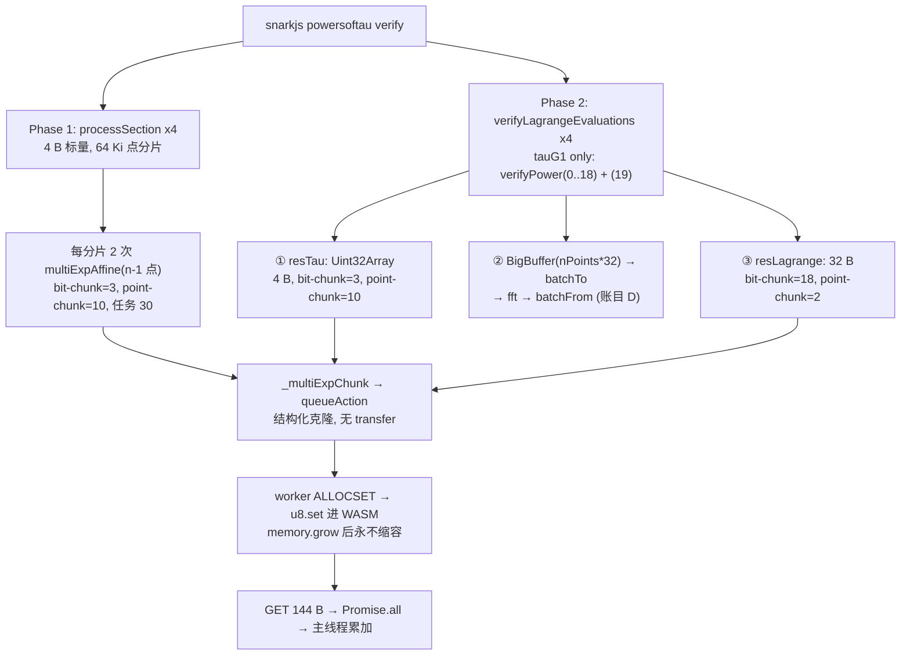
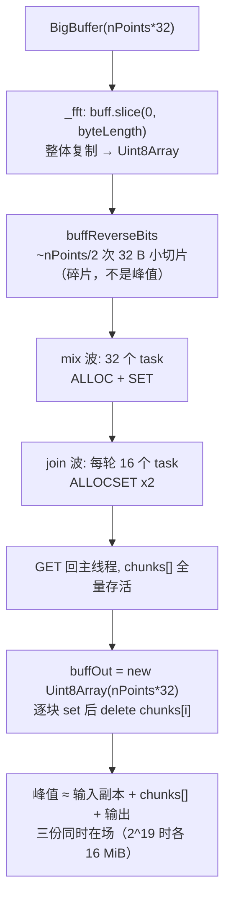

# M5 内存归因：探针设计与源码分配路径审计（M5-A.2）

- **状态**：A.2 修订稿（评审稿）。评审通过后才进入 M5-B 实现。
- **分支**：`experiment/m5-attribution`（未合入 `main`）。
- **基线**：`main @ 24a0dd3`；`ffjavascript 0.3.1`、`snarkjs 0.7.6`、`Node v22.22.2`、Windows、28 逻辑核。
- **本文件不含**：任何依赖改动、任何计算逻辑改动、任何新的实验数据。
- **配套工具**：`scripts/m5_budget.cjs`（纯静态算术，不插桩、不启动 snarkjs，用于复算本文件的账本）。

> 一句话定位：M4.1 测到的是"阶段区间内 Working Set 涨了 2.2 GiB"；M5 要把它拆成"哪一次分配、多少字节、活到什么时候"。
> 本文件先把源码里**必然发生**的复制点定死，再给出可被证伪的字节预算，最后定义能证实/推翻它的探针。

---

## 0. A.1 修订对照（相对 `e2bb900`）

| # | A 稿 | A.1 稿 | 依据 |
| --- | --- | --- | --- |
| 1 | 把 `tauG1` 的 MSM 当成一条 32 B 标量账目 | **拆成三条**：`processSection`（4 B）、`resTau`（4 B）、`resLagrange`（32 B） | `powersoftau_verify.js:361 / 425 / 454` |
| 2 | Phase 1 存量 **223 MiB**（按 32 B、22 bit-chunk、2 point-chunk） | **72.4 MiB**（4 B、3 bit-chunk、10 point-chunk，G2 段把 Worker 扩到 42 页） | `:361` + `:112-137` |
| 3 | "模型解释 98%，误差 2%" | **撤回**。改后模型段增量 2351 MiB 对实测 2160 MiB，**高出 8.9%** | §5.6（**"上界"身份已被 A.2 推翻**，见 §0.1 第 6 条） |
| 4 | 用"模型共存峰值"直接减"全程峰值" | **删除该比较**（不同相位不可比）。改为同窗口锚定：起始 current WS + 模型增量 | §5.6 |
| 5 | F14 写"p18 时 32 chunk × 8192 点" | **32 chunk × 16384 点**（`2^19/2^14`）；8192 是 `2^18` 的情形 | `engine_fft.js:13` |
| 6 | MB 与 MiB 混用（16.8 / 50.3） | 全文统一 **MiB**；`2^19×32 = 16 MiB`、`2^19×96 = 48 MiB` | —— |
| 7 | `prepare_phase2` 残差解释为"碎片/未释放" | 降级为**未解释残差**，不作机制断言 | §5.5、§10.6 |
| 8 | 验收门"探针值落在模型值 70%–100%" | **删除**。改为三层：切分逐字段相等 / 逐 Worker 页数对账 / 同刻四量对比 | §7.6 |

### 0.1 A.2 修订对照（相对 `dd51f3e`）

| # | A.1 稿 | A.2 稿 | 依据 |
| --- | --- | --- | --- |
| 1 | 账目只到 A（`processSection`）/ B（`resTau`）/ C（`resLagrange`） | **新增账目 D：`Fr.batchTo/FromMontgomery`**。p18 每个干净 Worker 被两次分配推到 **28 页**，28 个 Worker 合计 **49 MiB**；p16 不扩容 | `engine_batchconvert.js:23-32`；`wasm_field1.js:71` |
| 2 | HYP-1 只写"基址取 0（未实测）" | 明确为**下界假设**：真实基址只会**抬高**容量，不会降低；不参与任何"预测"表述 | §5.0 |
| 3 | HYP-2 以"大分片优先分配到不同 Worker"计算 | 明确**只用于构造上界，不代表实际调度顺序**；实际归属必须由 `worker_task.worker` 实测 | §5.0 |
| 4 | L2 允许"基址偏移的整页差" | **删除容差**。改为按事件顺序**逐 Worker 精确回放**，页数必须**逐一相等** | §7.6 |
| 5 | 同窗绝对量 `776 + 2351 = 3127` 对实测 2936，称 6.5% | **删除该相加比较**。在途字节 / WASM 容量 / Working Set 三者量纲不同，**不得相加当 WS 预测**；改为同刻并列 + 显式残差 | §5.6、§10.9 |
| 6 | 用**单次** `+2160 MiB` 代表"实测段增量"，并称模型"高出 8.9%、仍是上界" | **改为三次并列**：p18 `+2160/+2487/+2636`（均值 2428），p16 `+194/+207/+238`（均值 213）。p18 模型 0.97×（**低于**均值）、p16 2.8×（远高于），**方向相反 → "上界"不成立**；离散 ±10% 已大于模型偏差，**该比较不能判定模型对错** | §5.6；`m4_1_*_p1x_r{1,2,3}.json` 阶段标记 |
| 7 | §5.1 只列 4 个 phase-1 section | 补 **`betaG2`**（1 点，`processSectionBetaG2` 读 192 B 后 `fromRprLEM`/`toRprUncompressed`，**无 MSM、无 Worker、无 WASM 分配**） | `powersoftau_verify.js:316-338` |
| 8 | 未说明 phase 2 的四个 section 如何共享容量 | 补 M4.1 实测旁证：tauG1 段 +2160（r1）之后，tauG2/alphaTauG1/betaTauG1 只各 +266 / +230（r1），说明**容量被复用而非重新增长** | §5.6.1 |

---

### 0.2 评审勘误（M5-B 实施期补正，**不构成新修订**）

按评审裁定，A.2 直接通过，不再另开 A.3。下列五处属**文本与算术勘误**，在实施 M5-B 的同时就地改正：

| # | A.2 的写法 | 勘误后 | 依据 |
| --- | --- | --- | --- |
| 1 | 账目 D 记为"容量历史点（28 页/Worker、49 MiB）" | **独立冷启动容量预算**：本次运行 `grow` 次数 = 0、容量增量 = 0；M5-C 用实测基址重算后是 **30 页 / 52.5 MiB**，且只在"从 25 页起跑"时成立 | §5.4、§10.10 |
| 2 | §5.6.1 "tauG1 把 28 个 Worker 推到 988 页" | **19 个 @989 + 9 个 @551**（2 个 point-chunk：337,042 / 187,246 点，内层位块 19/20；A.2 写的 18+10 仍按外层 18 位块算） | §5.6.1、§5.3 |
| 3 | "tauG2 +55 页/Worker ≈ +96 MiB" | **`19×55 + 493 = 1,538` 页 = 96.1 MiB**（19 个大分片 + 1 个跨档补齐，其余 8 个不动；单 Worker 最大页数与池增量是两个量） | §5.6.1 |
| 4 | HYP-2 = "最坏归属上界" | 首轮映射是 `processWorks()` 顺序扫描的**推论**（workers `0..C-1`），迟到任务已证明无增长 → 升级为**条件于点预测** | §5.0.1、§10.3 |
| 5 | 主线程"64 MiB 同时存活" | 降级为**假设 P-1**：`slice()` 复制是必然（16 MiB/次），四者同时存活需探针判定 | §5.4、§10.12 |

另：§5.6 结论措辞由"同量级且噪声大于信号"改为**"现有测量尚不能验证静态模型的准确性"**（三次样本不足以支持统计表述）。

> 上面第 1、3 条在写就时仍假设 `alloc_base = 0`。M5-C 实测出 102,328 B 之后，本文件所有页数一律按
> 实测基址重算（`--base 102328`），因此 28→30 页、1,484→1,538 页的差异出现在此处而非 §5.4/§5.6.1 正文里。

---

## 1. 结论摘要（给评审的 9 条）

1. **must-fix 已修**：`snarkjs` 在三个地方喂不同宽度的标量——`processSection` 4 B、`resTau` 4 B、`resLagrange` 32 B。
   A 稿把 32 B 的位块放大（18 个 bit-chunk）套到了全部 MSM 上，导致 Phase 1 基线与"2% 吻合"两个结论都不成立。
2. **位块放大机制本身成立，但只对 32 B 路径成立，且位块数要按"分片点数"算**：p18 的 `resLagrange` 在 `2^19`
   点上是 2 个 point-chunk（337,042 / 187,246 点），内层 `pTSizes` 分别给 **19 / 20** 个位块 → **39 任务**、
   单任务 41.1 MiB、在途 **987.4 MiB**（这是"从 postMessage 到收到回复"的上端口径；只算 Worker 真正在跑的那段
   是 **932.6 MiB**，两者之差是排队中的副本）；而同一次 `verifyPower(19)` 里先跑的 `resTau`（4 B）只有 3 个位块 ×
   10 point-chunk = 30 任务、单任务 5.4 MiB、在途 146.4 MiB。
3. **Worker WASM 的双倍余量机制成立**（`alloc()` 把 `length` 加了两次），而且首轮映射是**确定的**：
   `processWorks()` 从 0 号 Worker 顺序取空闲（`threadman.js:191-198`），`_multiExpChunk()` 在 `await` 前把整批
   位块任务同步入队，所以首轮 28 个任务就是 workers 0..27。剩余任务（迟到任务）在 §4 被证明"任何 Worker 都吃得下"，
   故**总和与调度顺序无关**。`alloc_base` 已被实测（HYP-1 退役）：p10 全部任务都是 **102,328 B**。
4. **Phase 1 基线重算为 1,204 页 = 75.3 MiB**（28 × 43 页，实测基址），驱动项不是 G1 而是 **G2 的 `tauG2`**
   （`7021×192×2 + 102,328 > 25 页` → 43 页）；基址取 0 时是 1,176 页 = 73.5 MiB。按顺序回放，
   **28 个 Worker 全部到 43 页**，不存在"27 个 @42 + 1 个 @25"的尾部分片例外。
5. **单次引用 +2160 MiB 不可靠，模型也不是统一上界**：p18 三个 run 的 tauG1 段增量分别是
   **+2160 / +2487 / +2636**（均值 2428，极差 476 = ±10%），模型 **2,396.5** = 987.4 + 1,409.1 落在区间内（0.99×）；
   p16 三次是 **+194 / +207 / +238**（均值 213），模型 **594.2** = 265.1 + 329.1 为 **2.79×**。
   两个 power 的偏差方向相反，**所以"上界"这个身份也不成立**——三次实测的离散已经大于模型与实测的差，
   这个比较**不能用来判定模型对错**（§5.6）。
6. **原 H1（FFT 输入副本）在 `prepared_verify @ p18` 上只有约 32 MiB**（16 输入副本 + 16 输出；
   分片数组在同一时刻为空），相对 MSM 的 987 + 1,409 很小，**但"已排除"这个说法在 M5-E.1 被撤回**：
   FFT 的 Worker 消息缓冲区确实只有 14 MiB，可 `_fft` 主线程上的三份数据（`buff` / `chunks[]` / `buffOut`）
   的生命周期还没有建模，只能说"贡献未定量"。`prepare_phase2` 相反，FFT 才是主路径。
7. **账目 D（`Fr.batchTo/FromMontgomery`）此前漏记，现已补上，但它是"冷启动预算"而非本次扩容**：
   每个 chunk 做**两次**分配（`ALLOCSET` 599,168 B + `ALLOC` 599,168 B），若从 25 页起跑会被
   `alloc()` 的双计推到 **30 页/Worker**（28 个合计 **52.5 MiB**；基址 0 时 28 页）；但它在同一次 `verifyPower` 里
   **晚于** `resTau` 与前几档 `resLagrange`，届时 Worker 已是 249 / 112 / 43 页，所以**本次 grow 次数 = 0、
   容量增量 = 0**（p10 的 L2 已对 94 次 batchconvert 调用核对）。它必须被记录，但不得写成"52.5 MiB 增量"。
8. **容量池要按"单 Worker 最大页数"与"池增量"两个层次读**：tauG1 的 `resLagrange@2^19` 留下
   `19×989 + 9×551 = 23,750` 页（1,484.4 MiB，池增量 11,298 页 = 706.1 MiB）；tauG2 的 `resLagrange@2^18`
   把 **19** 个 Worker 从 989 抬到 1044（各 +55）、把**第 20 个**从 551 抬到 1044（+493），其余 8 个不动
   （496 < 551），**池增量 1,538 页 = 96.1 MiB**。写成"28 个 Worker 各 +55 页"会得到 1,540 页 = 96.25 MiB，
   总量只差 0.15 MiB 但归属完全不同——所以 L2 必须逐 Worker 核对。
9. **M5-E.1 用真实 grow 时间戳推翻了一个结论**：M5-E 说"在途峰时容量只有 778.3 MiB，两者不同时在场"。
   778.3 MiB 是"主线程已收到增长报告"的容量。把 `memory.grow` 的时间戳记进 `alloc()` 之后，在途峰那一刻
   的容量是 **1,484.4 MiB（p18，终值的 93.9%）/ 404.4 MiB（p16，94.8%）**——**两者同时在场**。
   同时 `send_bytes` 被拆成 `clone_buffer_bytes` / `wasm_alloc_bytes` / `worker_output_bytes`，
   batch 与 FFT 路径的旧口径分别虚高 3.0× / 2.2×。详见 `docs/M5_ATTRIBUTION.md`。

---

## 2. 审计方法与事实表

逐文件逐行读 `node_modules/ffjavascript`（0.3.1）与 `node_modules/snarkjs`（0.7.6）的**实际安装内容**。

| 编号 | 位置 | 事实 | 后果 |
| --- | --- | --- | --- |
| F1 | `threadman.js:21` | `MEM_SIZE = 25` 页（1.5625 MiB） | 首次大 ALLOCSET 必然触发 `memory.grow` |
| F2 | `threadman.js:104-119` | `concurrency = os.cpus().length`，上限 64 | 本机 = **28** 个 Worker、28 份独立线性内存 |
| F3 | `threadman_thread.js:4` | `MAXMEM = 32767` 页 | 单 Worker 上限 2 GiB |
| F4 | `threadman_thread.js:44-56` | `alloc()` 判据写成 `u32[0] + length > byteLength`，而 `u32[0]` 已 `+= length` | 实际要求 `byteLength ≥ top + 2·length` → 首个大分片使容量≈2× |
| F5 | `threadman_thread.js:58-62, 86-87` | `ALLOCSET` = `alloc` + `u8.set(整个 buffer)` | 消息克隆之外**再**复制一份进 WASM |
| F6 | `threadman_thread.js:108-110` | `GET` 用 `.slice()` 拷出 | 每次 MSM 任务一个 144 B 的 G1 结果 |
| F7 | `threadman_thread.js:115-117` | 任务结束只 `u32b[0] = oldAlloc` | 不缩容；Worker 容量是**单调高水位** |
| F8 | `threadman.js:196-213` | `queueAction` → `processWorks` → `postAction`，`transfers` 未传 | 点数据走结构化克隆 |
| F9 | `threadman.js:121-140` | 启动时 `postAction(..., [copyCode.buffer])` | 全路径**唯一**的 transfer list |
| F10 | `engine_multiexp.js:112-120` | `sScalar = floor(scalars.byteLength / nPoints)`；`bitChunk = pTSizes[log2(nPoints)]`；`nBitChunks = floor((8·sScalar−1)/bitChunk)+1` | 标量宽度**直接决定**位块数：4 B→3，32 B→18 |
| F11 | `engine_multiexp.js:122-137` | `chunkSize = floor(nPoints / (concurrency / nBitChunks))`，钳在 `[2^10, 2^22]`；每个 point-chunk 起 1 次 slice，`nBitChunks` 个任务共享它 | 位块数越大，point-chunk 越大，单任务载荷越大 |
| F12 | `engine_multiexp.js:131-132` | `buffBases.slice()` / `buffScalars.slice()` | 每块 1 次真复制（不是每任务 1 次） |
| F13 | `powersoftau_verify.js:361` | `scalars = getRandomBytes(4*(n-1))` | **Phase 1 标量是 4 B**，不是 32 B |
| F14 | `powersoftau_verify.js:371-372` | 每个 64 Ki 点分片跑**两次** MSM，各 `(n-1)` 点，顺序 await | Phase 1 的在途量按单次调用算，不相加 |
| F15 | `powersoftau_verify.js:425, 439` | `buff_r = new Uint32Array(nPoints)` 再转 `Uint8Array` | **`resTau` 标量 4 B**（`:452`） |
| F16 | `powersoftau_verify.js:454, 470-474` | `buff_r = new BigBuffer(nPoints*Fr.n8)`，经 batchToMontgomery → **fft** → batchFromMontgomery | **`resLagrange` 标量 32 B**（`:482`），且同一次迭代内还有一次全域 FFT |
| F17 | `engine_fft.js:13, 109-115` | `MAX_BITS_THREAD = 14`，且 `while (nChunks < concurrency)` 继续二分 | `2^19` → **32×16384**；`2^18` → 32×8192；`2^17` → 32×4096 |
| F18 | `engine_fft.js:73` | `buff = buff.slice(0, buff.byteLength)` | 整体输入复制一份；< 1 GiB 时 `BigBuffer.slice` 返回 `Uint8Array` 副本 |
| F19 | `web-worker 1.2.0 / cjs/node.js:168-170, 222-227` | `postMessage` 直通 `worker_threads`；worker 源码走 `VM.runInThisContext` | 克隆在发送端序列化；Worker 内无模块级 `require`，但有 `process`/`WebAssembly` |
| F20 | `threadman_thread.js:8-22` | **未实测**：模块初始化后 `u32[0]` 的静态数据基址 | 本文件所有容量按基址 = 0 计算，须由 M5-B 读真值 |

**两条设计约束**（由 F19 推出）：

- Worker 探针必须写在 `threadman_thread.js` 的 `thread()` **函数体内**——该函数被 `thread.toString()` 序列化成
  data URL 送进 Worker（`threadman.js:43`），闭包外的 helper 不会跟过去。
- Worker 侧不能写文件；遥测必须随计算结果一起回传，由主线程落盘。

---

## 3. 四条独立账目（A/B/C 按标量宽度分叉，D 是 batchconvert）

| 账目 | 源码 | 标量宽度 | 点数 | 典型位块数（p18 最大迭代） | 何时发生 |
| --- | --- | ---: | --- | ---: | --- |
| **A 阶段 1** | `processSection`（`:340-396`） | **4 B** | 每分片 65536，MSM 用 `n-1` | **3** | Phase 1，四个 section（`betaG2` 另走 `:316-338`，无 MSM） |
| **B `resTau`** | `verifyPower`（`:425-452`） | **4 B** | `2^p` | **3** | 每次 `verifyPower` 的第一步 |
| **C `resLagrange`** | `verifyPower`（`:454-482`） | **32 B** | `2^p` | **18**（p=19） | 同一 `verifyPower` 的第三步，FFT 之后 |
| **D batchconvert** | `engine_batchconvert.js:23-32`（`:470,474` 调用） | **32 B 进 / 32 B 出** | `2^p` | 无（不按位块切） | `resTau` 之后、FFT 前后各一次 |

**A 稿的错误就是把 C 的参数用在了 A 和 B 上。** A/B/C 三者不可合并：位块数差 6 倍，point-chunk 数与单任务载荷全部不同。
**D 不是 MSM**，它按 `concurrency` 等分、每块**两次分配**，作用是解释 §5.4 的 28 页事件与 JS 侧 48 MiB 瞬时副本。

### 3.1 MSM 路径（按账目分支）



### 3.2 FFT 路径（`resLagrange` 前置；`prepare_phase2` 的主路径）



---

## 4. 复制点清单（C1–C11）

探针事件用这套编号做 `site` 字段。

| ID | 位置 | 复制内容 | 字节（p18 `prepared_verify`） | 逻辑寿命 |
| --- | --- | --- | --- | --- |
| C1 | `powersoftau_verify.js:443-449` | 文件 → `BigBuffer buffG` | 48 MiB（`2^19·96`） | 单次 `verifyPower`（**两次 MSM 复用同一份**） |
| C2 | `engine_multiexp.js:131` | bases slice | 30.9 / 17.1 MiB（`resLagrange` 两块） | 到 `Promise.all` 完成 |
| C3 | `engine_multiexp.js:132` | scalars slice | 10.3 / 5.7 MiB（同上） | 同上 |
| C4 | `threadman.js:186` → `worker_threads` | 结构化克隆 | 41.1 / 22.9 MiB × 18 次/块 | 单任务 |
| C5 | `threadman_thread.js:58-62` | 克隆 → WASM 线性内存 | 同上（另加 grow 余量） | **到进程结束** |
| C6 | `threadman_thread.js:108-110` | WASM → 144 B `Uint8Array` | 144 B × 36 | 单任务 |
| C7 | `powersoftau_verify.js:425` | `resTau` 标量 `Uint32Array` | 2 MiB（`2^19·4`） | 单次 `verifyPower` |
| C8 | `powersoftau_verify.js:454` | `resLagrange` 标量 `BigBuffer` | 16 MiB（`2^19·32`） | 单次 `verifyPower` |
| C9 | `engine_fft.js:73` | FFT 整体输入复制 | 16 MiB | 单次 `_fft` |
| C10 | `engine_fft.js:123-148, 170-205` | FFT 分片收发 | mix 在途 16 MiB；join 每轮 ≤ 16 MiB | 单波 |
| C11 | `engine_fft.js:225-245` | FFT 输出缓冲 + 逐块 `set` | 16 MiB | 单次 `_fft` |

> 单位口径：`2^19×32 B = 16,777,216 B ≡ 16 MiB`；`2^19×96 B = 50,331,648 B ≡ 48 MiB`。
> A 稿里的 "16.8 MiB / 50.3 MiB" 是把十进制 MB 混进了 MiB 列，已全部改正。

---

## 5. 静态账本（模型，非测量）

`scripts/m5_budget.cjs` 复现全部算术：

```
node scripts/m5_budget.cjs --power 18 --operation prepared_verify
node scripts/m5_budget.cjs --power 18 --operation phase1
node scripts/m5_budget.cjs --power 18 --operation prepare_phase2 --json
```

**两个边界假设：只定义区间端点，不是预测值**（下表给出方向与推翻方式，二者都必须在 M5-B 里被实测替换）：

| 假设 | 内容 | 方向 | 如何被替换 |
| --- | --- | --- | --- |
| ~~HYP-1~~ | ~~Worker 初始化后 `u32[0]` 基址取 0~~ | **已被 M5-C 实测替换**：p10 的 10,084 个任务全部 `alloc_base = 102,328 B`；本文件此后一律以 `--base 102328` 出数，基址 0 的值只在脚注里作为对照 | 已完成（`worker_task.alloc_base`） |
| **HYP-2** | 首轮任务按 `queueAction` 的入队顺序落到 workers `0..C-1` | **点预测（条件于 HYP-1）**：`processWorks()` 从 0 号扫起、`_multiExpChunk` 在 `await` 前同步入队，所以首个 `C` 个任务与 Worker 编号**一一对应**；迟到任务另证"任何 Worker 都吃得下"（见 §5.0.1），故总和与运行时顺序无关 | `worker_task.worker`：逐任务记录真实 Worker 号；若首轮出现非 `0..C-1` 的映射，F8 的读法错了 |

#### 5.0.1 首轮映射为什么是确定的（A.2 之后补证）

三个源码事实合起来把"调度顺序"从假设变成推论：

1. `_multiExp` 外层按 **point-chunk** 递增（`engine_multiexp.js:128`），`_multiExpChunk` 内部对 **bit-chunk**
   同步 `queueAction`（`:57-76`），且 `await Promise.all` 在其后（`:78`）。所以入队顺序是
   `pc0·bc0 … pc0·bc17, pc1·bc0 …`。
2. `queueAction` 立即 `processWorks()`（`threadman.js:212`），`processWorks` 从 `i=0` 找第一个空闲 Worker
   （`:192-197`），`postAction` 标记 `working[i]=true`。所以前 `C` 个任务依次占满 `0..C-1`。
3. 迟到任务（第 `C` 个之后）只在其需求 ≤ 当前**最小**容量时被证明无增长。计算器对 p16/p18 的全部
   445 次调用逐一验证该条件成立（`late_provably_free = true`，0 例外），因此容量总和与"谁先空闲"无关。

> 结论：除 `alloc_base` 外，§5 的容量表已经是**点预测**，可以直接作为 L2 的无容差判据；
> 它是否成立由 `worker_task.wasm_after` 逐 Worker 判定，而不是靠"接近"。


### 5.1 账目 A：Phase 1（4 B 标量）

`node scripts/m5_budget.cjs --power 18 --operation phase1 --base 102328`（顺序回放真实调用顺序）：

| section | 群 | 点数 | 64 Ki 分片 | MSM 点数 | 外层 bitChunk | 内层位块（每分片各算） | point-chunk | 每 64 Ki 任务数 | 单任务 MiB | 在途 MiB | 单 Worker 页（最大） | 段末容量池（页） |
| --- | --- | ---: | ---: | ---: | ---: | --- | ---: | ---: | ---: | ---: | ---: | ---: |
| tauG1 | G1 | 524287 | 8 | 65535 | 12 | 9×9 + 1×8 | 10 | 40 | 0.7 | 18.7 | **25** | 700 |
| **tauG2** | **G2** | 262144 | 4 | 65535 | 12 | 9×9 + 1×8 | 10 | 40 | 1.3 | 36.7 | **43** | **1204** |
| alphatauG1 | G1 | 262144 | 4 | 65535 | 12 | 9×9 + 1×8 | 10 | 40 | 0.7 | 18.7 | 43 | 1204 |
| betatauG1 | G1 | 262144 | 4 | 65535 | 12 | 9×9 + 1×8 | 10 | 40 | 0.7 | 18.7 | 43 | 1204 |

- **phase 1 结束 = phase 2 起点：1,204 页 = 75.3 MiB（28 × 43 页）**。基址取 0 时是 1,176 页 = 73.5 MiB，
  差 2 页/Worker 全部来自 102,328 B 基址把一个 43 页判据推过了整页边界——**不是新的分配，只是同一个判据的舍入**。
- G2 满额分片 7021 点：`7021×192 = 1,348,032 B`，按 `alloc()` 双计需
  `floor((102,328 + 2×1,348,032) / 65,536) + 1 = 43` 页。
- G1 同尺寸分片 `7021×96`：判据远低于 25 页 → **不扩容**，所以 tauG1 段结束后池仍是 700 页。
- **A 稿与 A.2 稿的"27 个 @42 页 + 1 个 @25 页"都不成立**。那个数字来自"每个 section 独立估算"的旧模型，
  它假设尾部 point-chunk 只落在一个 Worker 上。按真实调用顺序（batch → 两次 MSM，逐 64 Ki 分片推进），
  tauG2 的 8 次 MSM 调用**每次首轮都排满 28 个满额分片**（首轮 28 个任务全部来自前 7 个 point-chunk 的 4 个位块），
  所以 **28 个 Worker 全部到 43 页**，没有"只跑尾部分片"的例外。
- 旧模型的另一个错在**位块数**：它用外层 `pTSizes[log2(n)] = 12` 得到 3 个位块，
  而 `_multiExpChunk` 按**分片点数**重算（见 §5.8 的源码事实），7021 点对应 `pTSizes[12] = 9` → **4 个位块**，
  每个 64 Ki 分片产生 **40** 个任务而不是 30。任务数只影响调用形状与 L1 判据，不影响页数。

> 这是 A 稿最实质的错误：223 MiB 建立在"22 个位块、2 个 point-chunk"上。4 B 标量只有 3–4 个位块、10 个
> point-chunk，单任务从 41 MiB 降到 1.3 MiB，扩容后的容量自然只有 43 页。

### 5.2 账目 B：`resTau`（4 B）

| p | 点数 | 外层 bitChunk | 位块数 | point-chunk（各分片点数） | 任务数 | 首轮页数 | 单任务 MiB | 在途 MiB |
| ---: | ---: | ---: | ---: | --- | ---: | --- | ---: | ---: |
| 19 | 524288 | 15 | 3 | 56173×9 + 18731 | 30 | **27×167 + 1×57** | 5.4 | 146.4 |
| 18 | 262144 | 14 | 3 | 28086×9 + 9370 | 31 | 27×84 + 1×30 | 2.7 | 73.2 |

`resTau@2^19` 的 167 页（10.4 MiB/Worker）**低于**同一次迭代 `resLagrange` 的 989 页，所以它不抬高最终高水位；
但它在**时间上先发生**（`:452` 在 `:482` 之前），因此决定了 tauG1 窗口**前半段的** WS 形状。
逐 Worker 看，首轮 28 个任务是 **27 × 167 页 + 1 × 57 页**（尾部 point-chunk 18,731 点），
所以"每个 Worker 都留下 167 页"不成立——这与 §5.4 的 29/30 页是同一件事：

1. `resTau` 在本文件的顺序回放里 **一次 grow 都没有**：它的调用发生在 tauG1 前几个 power 的
   `resLagrange` 已经把容量池推到 12,452 页之后（`p19.resTau` 的 `delta_pages = 0`）。
   "167 页"是**冷启动需求**（在 25 页 Worker 上执行时需要的页数），不是本段实际发生的扩容。
2. 冷启动需求 167 页 > phase-1 池的 43 页，所以**如果** `resTau` 排在 phase 2 最前面，它就是 driver；
   实际它排在 `resLagrange(p0..p18)` 之后，因此只是把"已经存在的容量"再触碰一次。

### 5.3 账目 C：`resLagrange`（32 B，FFT 之后）

| section | p | 群 | 点数 | point-chunk | 内层位块 | 任务数 | 首轮页数 | 单任务 MiB | 在途 MiB | 段内池增量 |
| --- | ---: | --- | ---: | --- | --- | ---: | --- | ---: | ---: | ---: |
| tauG1 | 19 | G1 | 524288 | 337042 + 187246 | **19 / 20** | **39** | **19×989 + 9×551** | 41.1 | **987.4** | +11,298 页 = 706.1 MiB |
| tauG1 | 18 | G1 | 262144 | 177883 + 84261 | 20 / 20 | 40 | 20×523 + 8×249 | 21.7 | 516.6 | +5,982 页 = 373.9 MiB |
| tauG2 | 18 | G2 | 262144 | 177883 + 84261 | 20 / 20 | 40 | **20×1044 + 8×496** | 38.0 | 904.0 | **+1,538 页 = 96.1 MiB** |

- 单任务 `337,042 × 128 B = 41.1 MiB`；克隆总量 `18 × 524,288 × 128 B = 1152 MiB`，**与并发度无关**。
- 989 页 = `floor((102,328 + 2×32,356,032) / 65,536) + 1`；551 页对应 187,246 点分片。容量 ≠ 驻留。
- **两档之间要分清"单 Worker 页数"与"池增量"**：`resLagrange@p19` 让 28 个 Worker 全部扩容，
  池增量 11,298 页；`tauG2@p18` 只让 20 个 Worker 扩容，池增量 1,538 页。前者是主 driver，
  后者是在已扩容量上"补 55 页的边角"（详见 §5.6.1）。

### 5.4 账目 D：`Fr.batchTo/FromMontgomery`（32 B 进出）

`verifyPower` 在 `resTau` 之后、`resLagrange` 之前，对**整个 `2^p` 标量缓冲**做两次 batchconvert
（`:470` 与 `:474`）。两者都是 `buildBatchConvert(tm, "frm_batch*", 32, 32)`（`wasm_field1.js:71`），
每个 chunk 的任务是 `ALLOCSET var0 (n×32)` + `ALLOC var1 (n×32)` —— **两次分配**，合计 `2·n·32` 字节。

| p | 点数 | 每 chunk 点（末块） | ALLOCSET / ALLOC (B) | 冷启动页数 | 本次实跑 `delta_pages` | 冷启动预算合计 |
| ---: | ---: | --- | ---: | ---: | ---: | ---: |
| 19 | 524,288 | 18,724（18,740） | 599,168 / 599,168 | **30** | **0** | **52.5 MiB**（28 × 30 页） |
| 18 | 262,144 | 9,362（9,370） | 299,584 / 299,584 | 25 | 0 | 43.75 MiB（28 × 25 页） |
| 17（p16 的最大档） | 131,072 | 4,681（4,685） | 149,792 / 149,792 | 25 | 0 | 43.75 MiB |

回放口径（`threadman_thread.js:44-56`，基址 102,328 B、初始 25 页 = 1,638,400 B），以 p19 末块 18,740 点为例：

1. `ALLOCSET` 后 `top = 102,328 + 599,680 = 702,008`，判据 `top + 599,680 = 1,301,688 < 1,638,400` → **不扩容**；
2. `ALLOC` 后 `top = 1,301,688`，判据 `top + 599,680 = 1,901,368 > 1,638,400` →
   `requiredPages = floor(1,901,368 / 65,536) + 1 = **30**`。

**30 页几乎全部由 F4 的双计造成**：若不双计，只需 `floor(1,301,688 / 65,536) + 1 = 20` 页。
基址 0 时同一判据给 28 页——**28 与 30 的差只来自那 102,328 B**，这也说明"基址取 0"不是无所谓的近似。

**但它不是本次运行中真实发生过的一次扩容**——`batchToMontgomery` 在同一次 `verifyPower` 里晚于 `resTau`，
那时 Worker 的容量早已远超 30 页。顺序回放给出的逐 Worker 事实是：

| power | 调用前逐 Worker 最小页数 | batchconvert 需要 | `delta_pages` | grow 次数 |
| ---: | ---: | ---: | ---: | --- |
| 19 | 249 | 30 | **0** | **0** |
| 18 | 112 | 25 | **0** | 0 |
| 16 | 43 | 25 | **0** | 0 |

所以账目 D 的正确记法（按评审裁定改写）是：

> **独立冷启动容量预算**：若 Worker 从初始 25 页执行 BatchConvert，p19 需要 30 页/Worker，合计 52.5 MiB。
> 实际 `prepared_verify` 中该阶段发生在 `resTau` / 前几档 `resLagrange` 之后，**不触发新的 WASM 扩容**，
> 因此本阶段容量增量为 **0**。M5-B 以逐 Worker 的 `wasm_before / wasm_after` 验证这一条
> （L2 已对 p10 全部 94 次 batchconvert 调用核对：0 次 grow）。

它只有在两种条件下才变成约束：① `alloc_base` 远大于 0（已排除：实测 102,328 B，仅抬高 2 页）；
② `resTau` / 低阶 `resLagrange` 路径被改造或去除（M6 的候选场景，本轮明令不碰）。

### 5.5 其他项（p18）

| 项 | 值 | 依据 |
| --- | ---: | --- |
| Fr FFT @`2^19`（`resLagrange` 前置） | 32×16384，在途 16 / Worker 43.8 / 输入副本 16 / 输出 16 MiB | F17, F18 |
| Fr batchTo/FromMontgomery @`2^19` | 见 **§5.4 账目 D**（冷启动 30 页 / 52.5 MiB，实跑增量 0） | `engine_batchconvert.js:23-32` |
| FastFile 页池 | 52.8 MiB（`2^19×192 B` 的 G2 读，M4.1 已测） | — |

`prepare_phase2`（对照，不同操作，由 `--operation prepare_phase2` 输出）：p18 最大 ifft 为 32×16384 点，
在途 72 / Worker 容量 190.8 / 装配（输入副本 48 + `chunks[]` 72 + 输出 48 = 168）MiB，模型合计 **≈ 431 MiB**；
M3 实测峰值 1610 MiB，**差额约 1180 MiB 目前无法归属**（见 §10.6）。这个差额不用于支撑任何机制断言。

### 5.6 增量对账（只用增量；不跨量纲相加去"预测 WS"）

M4.1 的记录里"`+2160 MiB`"是"phase-2 起始标记 → tauG2 标记"之间 `current WS` 的变化，**它本身是一个增量**，
所以只能与**同性质的增量**对话，不能用它去比模型的"共存绝对值"，更不能把模型的几个量相加后宣称
"这就是 WS 预测值"。

**先把单次引用换掉**：三个 run 的同一段增量（`results/raw/m4_1_prepared_verify_p1x_r{1,2,3}.json` 的阶段标记）如下。

| 量 | p16 | p18 |
| --- | ---: | ---: |
| 实测段增量 r1 / r2 / r3 | +194 / +207 / +238 | +2160 / +2487 / +2636 |
| 实测均值（极差） | **213**（44） | **2428**（476，±10%） |
| 模型：`resLagrange` 在途（JS 字节） | 265.1 | 987.4 |
| 模型：段内容量池增量（WASM 地址空间，顺序回放） | 329.1 | 1409.1 |
| **模型段增量（两者之和）** | **594.2** | **2396.5** |
| 模型 / 实测均值 | **2.79×** | **0.99×** |
| 模型落在实测区间内？ | 否 | **是**（2160–2636） |

> 口径变化（M5-B）：容量项不再写"Worker 容量合计 − phase-1 基线"，而是直接用顺序回放给出的
> **段内容量池增量**（p16：1,204 → 6,470 页；p18：1,204 → 23,750 页）。两者在数学上等价，
> 但旧写法把 72.4 当常数到处减，掩盖了"基线本身也是模型量"这一点；现在基线固定为 75.3 MiB 并只出现一次。

**三条必须写死的读法**：

1. **"模型是上界"这个身份不成立**：p18 的模型 **低于**均值（0.99×），p16 的模型 **高于**均值（2.79×）。
   方向相反，说明这两档的主导项不同（p16 由固定开销与未写满的容量主导，p18 由在途与真实扩容主导），
   而不是"模型统一保守"。
2. **现有测量尚不能验证静态模型的准确性**：p18 的模型值落在三次观测范围内（2160–2636），p16 的模型值约为
   实测均值的 **2.79 倍**。不同规模下的偏差方向与幅度不同，且 p18 三次的极差 476 MiB **大于**模型与均值的
   差（−31.5 MiB）。因此现阶段**撤回模型上界判断与精度判断**，不写"吻合 x%"、不写"偏高 x%"，
   后续以逐 Worker 遥测与同刻内存指标为准。
   （三次样本不足以支持"噪声"这类统计表述，故本文件不再使用"噪声大于信号"的说法。）
3. **分子是两种不同东西的和**：在途字节是 JS 堆/`arrayBuffers` 的真实副本；容量增量是 WASM 线性内存的
   **地址空间**，扩了不等于写过、更不等于驻留。相加隐含"两者同时驻留且全部计入 WS"的假设。
   分母 `current WS` 又是操作系统在某一采样点的驻留页集合，既不含未触碰的 WASM 页，也可能滞后于
   V8 尚未回收的 ArrayBuffer。**三者只能并列，不能相加。**

因此：**不在本文件里做任何"模型吻合 WS"的断言**。§5.4 的账目与 §5.3 的在途量只在 §7.6 的 L3
（同刻并列四个量 + 残差区间）里才有意义。A.1 稿的 `776 + 2351 = 3127` 对 2936 的 6.5% 比较**已删除**。

仍成立的一条读法：**p16 的 1627 MiB 与全程峰值 1657 MiB 接近纯属巧合**——p16 的全程峰值出现在 tauG1
窗口**之外**。这正是"不能拿全程峰值比同窗模型"的实例。

### 5.6.1 phase 2 的四个 section **共用容量**，不是四次独立增长

`verifyLagrangeEvaluations` 在一次 phase 2 里被调用 **4 次**（`:271-282`）：`tauG1`(G1, section 2)、
`tauG2`(G2, 3)、`alphaTauG1`(G1, 4)、`betaTauG1`(G1, 5)。只有 `tauSection == 2` 会多跑一次
`verifyPower(power+1)`（`:406-409`），所以**只有 tauG1 的最大迭代到 `2^19`，其余三个到 `2^18`**。

如果按"四个 section 各涨 2351 MiB"推，p18 会到约 10 GiB —— 实测不是这样：

| section 起点标记（r1） | current WS | 相对上一段 |
| --- | ---: | ---: |
| phase-2 tauG1 开始 | 776 MiB | — |
| phase-2 tauG2 开始 | 2936 MiB | **+2160** |
| phase-2 alphaTauG1 开始 | 3202 MiB | +266 |
| phase-2 betaTauG1 开始 | 3432 MiB | +230 |
| 全程峰值（r1 / r2 / r3） | 3738 / 3894 / 3721 MiB | — |

原因是 **WASM 容量单调且不缩容**（F7）：tauG1 已经把容量池推到 1,484.4 MiB，后面三段的需求
（tauG2 的 1044 页、G1 @`2^18` 的 523 页）**只补增量、不重新分配**。

**A.2 稿在这里写错了两处，现按源码 + M5-C 实测更正**（完整修正表见 §5.8）：

1. "28 个 Worker 都到 988 页"不成立。p18 的 `resLagrange@2^19` 是 2 个 point-chunk（337,042 点 / 187,246 点），
   而**位块数由 `_multiExpChunk` 按分片点数重算**（`engine_multiexp.js:53`），分别是 **19 / 20**，所以任务数
   是 39 而不是 36，首轮 28 个任务 = **19 个大分片 + 9 个尾部分片** →
   **19 个 Worker @989 页、9 个 @551 页**（实测基址 102,328 B；基址取 0 时是 988 / 549）。
2. 因此 tauG2 的容量增量不是"28 × 55 页 ≈ 96 MiB"。tauG2@`2^18` 的首轮是 **20 个大分片 + 8 个尾部分片**
   （两个 chunk 都是 20 个位块），20 个 Worker 落在 `0..19`：

   | Worker | 之前 | 首轮接到 | 之后 | 增量 |
   | ---: | ---: | ---: | ---: | ---: |
   | 0–18（19 个） | 989 | 1044 页大分片 | 1044 | **+55** |
   | 19（1 个） | 551 | 1044 页大分片 | 1044 | **+493** |
   | 20–27（8 个） | 551 | 496 页尾部分片 | 551 | 0（496 < 551） |

   `Δ池 = 19 × 55 + 493 = 1,538` 页 = **96.1 MiB**。若按"28 个 Worker 各 +55 页"计会得到 1,540 页 = 96.25 MiB，
   **总量只差 0.15 MiB 但归属完全不同**——所以 L2 必须逐 Worker 核对，不能只比总量。

> 对 M5 的直接含义：`resLagrange` 的容量账目要分两层看——**单 Worker 最大页数** 989 → 1044（tauG2 更高），
> 而**容量池增量**只有 +96.1 MiB。两者不可混用；L2 必须逐 Worker 核对 `989/551/1044/496` 这四个值。
> 实测 +266 MiB（r1，tauG2 段 WS 增量）与 96.1 MiB 不是同一量纲：前者含新触碰的页与页池，
> 后者只是线性内存容量，**不得相互解释**。


### 5.7 外推

A 稿的 p19–p21 外推表**删除**。理由：模型在 p16 上差 2.8×，用它外推两档之外没有意义，
且 M3 已撤回同类估算。只保留定性陈述：`prepared_verify` 的单次分配量随 `N` 线性增长，
Worker 容量由"最大 point-chunk"决定、在并发度固定时同样随 `N` 增长，因此 p20 以上在本机（31.7 GiB）
存在风险；**要报 p19+ 的数必须实测**。

### 5.8 M5-C 首次实测（p10）：探针把静态账本里的两个假设直接判掉了

`prepared_verify @ p10`（`measure_m5.ps1 -Mode trace -Power 10`）第一次跑通全链路，30,537 条事件，
2,082 ms。这一档的绝对值小（phase 1 只有 2,047 点），但**结构性问题已经能回答**：

| 项 | 静态账本（A.2） | 实测 | 判定 |
| --- | --- | --- | --- |
| Worker 分配器基址 | HYP-1：取 0（"下界"，未实测） | **102,328 B**，10,084 个任务**全部相同** | **HYP-1 退役**；此后一律 `--base 102328` |
| 调用序列（L1） | 237 次调用、任务数逐调用 | 237/237 全部匹配（`kind` + `n_points/s_scalar/s_in/s_out/bit_chunk/n_bit/chunk_size/points_in_chunk/n_chunks`）；`task_send` 10,084 条 | **L1 PASS** |
| 逐 Worker 扩容史（L2） | 从基址回放，页数与 `wasm_after` 逐一相等 | 28 个 Worker、10,084 个任务全部回放一致，**0 个不符**；`maxpages = 25` | **L2 PASS（无容差）** |
| 账目 D（batchconvert） | 冷启动 25–30 页；本次 `grow = 0` | 94 次 batchconvert 调用，**0 次 grow**，`wasm_before = wasm_after = 25` | 与"增量 0"一致 |
| phase 1 池 | p10 下 G1 分片远小于 25 页 → 不扩容 | 700 页 = 43.75 MiB（28 × 25） | 一致 |

**两个只有实测才能给出的结论**：

1. **`alloc_base = 102,328 B` 不是 0，也不是"约 100 KiB 无所谓"**：它把 p19 的 `resLagrange` 从 988 页推到
   989、把 batchconvert 从 28 页推到 30 页。方向与 A.2 的判断一致（只抬高 `requiredPages`），幅度是整页级，
   但**页数是 L2 的判据，所以这一页之差必须在模型里显式存在**。
2. **`_multiExpChunk` 按分片点数重算位块数**（`engine_multiexp.js:53-54`）——A.2 全程没发现这条源码事实。
   它使 p11 的 `resTau` 从 8 个任务变成 10 个，也把本节所有"每 64 Ki 分片任务数"从 30 改成 40。
   这条是被 **L1 抓出来的**（`#67 msm tauG1.p11.resTau: tasks expected 8, observed 10`），
   不是被推理出来的：先有探针逐调用计数，才回头找到那两行代码。

**24 个 `unlabeled` 任务**（占 10,084 的 0.24%）不属于漏记：它们的签名为
`allocs = [144, 288, 288, 20,448, 576]`，是 snarkjs 在主线程内联构造的 3 点 G1 MSM（`timesScalar` 路径，
`cli.cjs:3555+`），没有经过任何 `queueAction` 调用点，因此拿不到 `site`。探针按"记录但标 `unlabeled`"处理，
L1 只对它做"存在且可回放"的校验，不计入逐调用比对。

### 5.9 扰动预算：探针本身会不会改变被测对象

#### p10，三模式各 5 次（探针 v2，M5-E.1 重测）

`results/raw/m5e10/` 下三组各 5 次，同一 fixture、同一命令行，唯一差别是"加载谁 + 是否写 JSONL"：

| 模式 | 发生了什么 | peak WS（MiB，5 次） | 中位 | 耗时（ms，5 次） | 中位 |
| --- | --- | --- | ---: | --- | ---: |
| `pristine` | `node_modules` + 无 hook | 557.9 / 560.3 / 550.0 / 609.8 / 576.5 | **560** | 2089 / 1885 / 1955 / 1908 / 1858 | **1,908** |
| `vendor` | vendor 副本 + hook，`M5_TRACE=0` | 564.3 / 565.7 / 625.3 / 565.7 / 631.2 | **566** | 1958 / 1925 / 1972 / 1935 / 1952 | **1,952** |
| `trace` | vendor 副本 + hook，`M5_TRACE=1` | 565.2 / 570.2 / 559.1 / 565.6 / 589.8 | **565** | 2077 / 2001 / 1989 / 2097 / 2124 | **2,077** |

三条结论（与探针 v1 一致，量级未变）：

1. **换 bundle 本身基本免费**：中位差 44 ms（2.3%），且三次 `vendor` 读数落在 `pristine` 的区间内。
2. **写 JSONL 有约 +9% 的固定成本**：中位差 +169 ms（相对 pristine +8.9%）。30,537 条事件、6.9 MB 落盘。
   任何"trace vs pristine 的耗时对比"都必须先声明这个系统性偏差。
3. **peak WS 无法判定扰动**：三组区间完全重叠（550–631 MiB），同一模式内的极差就有 42–66 MiB，
   大于模式之间的差。

#### p16 / p18：真实规模上的交错复核

| power | pristine peak WS | trace peak WS | pristine 耗时 | trace 耗时 |
| --- | --- | --- | --- | --- |
| 16 | 1,636.5 / 1,656.9 / 1,571.0 | 1,646.2 / 1,616.0 / 1,625.0 | 12.7 / 13.7 / 13.8 s | 13.3 / 13.4 / 13.9 s |
| 18 | 3,687.0 / 3,640.5 / 3,883.8 | 3,675.6 / 3,861.1 / 3,741.1 | 42.6 / 43.4 / 42.5 s | 42.8 / 43.3 / 60.5 s |

- p16 的耗时代价约 **+2%**，p18 约 **+1%**（一次 60.5 s 的离群值按噪声处理）——9% 的写盘成本被更长的运行摊薄。
- peak WS 在两档都是区间重叠，**没有一档能靠 WS 分辨出模式差**。

> 这也回溯修正了 M4.1 的读法：M4.1 每档三次读数、把极差当"±10% 噪声"是过强的表述。
> 即使同一台机器同一天，p18 的 peak WS 三次就分布在 3,640–3,884 MiB；换一天重跑又是 3,676–3,861。
> **任何跨批次比较 WS 的做法都不成立**，只有同一批交错运行之间的比较才有意义。

---

## 6. 可检验假设---

## 6. 可检验假设

阈值全部改为**绝对量**，不再使用百分比区间。

| 假设 | 内容 | 证实证据 | 推翻条件 |
| --- | --- | --- | --- |
| **H-A** | p18 tauG1 段的增长主要来自 `resLagrange` 的克隆在途 | `task_send` 在途时间序列的峰 ≥ 800 MiB，且与 WS 上升同相位 | 在途峰 < 500 MiB |
| **H-B** | Worker 容量 ≈ 2× 首个大分片（`alloc()` 双计），任务结束后不回落 | 逐 Worker 回放得 989 页（`alloc_base` 用实测 102,328 B 代入后**精确相等，无容差**）；`grows ≥ 1`；结束后采样不下降 | 回放页数与实测不符（F4 读错或命令流漏记）或扩容后回落 |
| **H-C** | p18 `prepared_verify` 中 FFT + FastFile 合计 < 160 MiB | C9–C11 记账 + 页池快照 | 合计 > 300 MiB |
| **H-D** | `prepare_phase2` 的峰值主体**无法**由任何单次分配解释 | `arrayBuffers` 高水位 ≫ 探针在途量，且差额随时间累积 | 探针能逐项对上 ≥ 80% 的高水位 |

H-D 只声称"模型不足"，**不预设**机制是碎片、未释放还是未统计的外部内存。

---

## 7. 探针规格（M5-B）

### 7.1 形态、开关与**自证**

- **不修改 `node_modules`**：`npm pack ffjavascript@0.3.1` 取固定 tarball（记录 sha256），解到
  `vendor/ffjavascript-0.3.1-m5/`，在副本上打 `patches/m5-instrumentation.patch`。
- `scripts/m5_resolve_hook.cjs` 用 `Module._resolveFilename` 重定向，与 M4 的 `--require` 机制一致。
- 开关：`M5_TRACE=1` 激活；`M5_OUT=<path>.jsonl` 指定输出；缺省时走与原版相同的代码路径与返回值形状。
- **自证（新增，防"以为插桩了其实没有"）**：每次运行的第一条 JSONL 必须是

  ```json
  {"ev":"provenance","resolved":"<绝对路径>","sha256":"<副本实现文件的哈希>",
   "patch_sha256":"<patch 的哈希>","ffjavascript_version":"0.3.1","node":"v22.22.2"}
  ```

  并把 `require.resolve('ffjavascript')` 的实际返回值打到 stdout。
  **若 `resolved` 指向 `node_modules/ffjavascript`，整次运行作废**（脚本非零退出）。
- Worker 内的开关同样读 `process.env.M5_TRACE`（`worker_threads` 默认继承父进程 env）；`M5_OUT` 在 Worker 内无效。

### 7.2 遥测通道（不打断原有 Promise 协议）

Worker 现有协议是 `self.postMessage(runTask(data))`（`:17-25`），主线程 `getOnMsg` 直接 `resolve(data)`
（`threadman.js:145-158`）。**额外 `postMessage` 一条遥测会被当成任务完成**——必须避免。

```js
// threadman.js:145-158
let payload = data;
if (payload && payload.__m5) {      // 仅 M5_TRACE=1 存在
    tm.m5.ingest(payload.__m5, i);
    payload = payload.out;          // 对外形状与 ctx.out 完全一致
}
tm.working[i] = false;
tm.pendingDeferreds[i].resolve(payload);
tm.processWorks();
```

```js
// threadman_thread.js, runTask() 末尾（:117 return ctx.out）
return M5_ON ? { __m5: snapshot, out: ctx.out } : ctx.out;   // 关闭时零差异
```

### 7.3 任务上下文**在调用点显式绑定**（A.2 修正：不是只绑 MSM）

`processWorks()` 是延迟调度的：任务若在发送时刻读"当前全局状态"，它的 `site` 可能已被下一次调用覆盖。
A.2 只描述了 `_multiExp` 内部生成 `call_id`，那不足以覆盖 `batchConvert` / `_fft` / `_fftJoinExt` /
`fftJoin` / `fftFinal` / `batchLEMtoU`——它们同样走 `queueAction`，同样会延迟调度。

因此改为**每个引擎入口各自建 ctx，逐层下传，入队时绑到任务上**：

```js
// engine_multiexp.js:91-137
const ctx = m5.call('msm', {group: groupName, n_points: nPoints, s_scalar: sScalar,
                            bit_chunk: bitChunkSize, n_bit: nChunks});
for (let i = 0; i < nPoints; i += chunkSize) {
    const sub = m5.derive(ctx, {pc_idx: i / chunkSize, points: n});
    opPromises.push(_multiExpChunk(buffBasesChunk, buffScalarsChunk, inType, logger, logText, sub));
}
// _multiExpChunk -> G.tm.queueAction(task, undefined, m5.derive(sub, {bc_idx: i}))
```

- `m5.call()` 分配 `call_id` 并发一条 `*_plan` 事件；`m5.derive()` 只继承 `call_id` 与已定字段，不读全局。
- `queueAction(actionData, transfers, ctx)` 第三参可选。`ctx` 为 `undefined` 时记 `site:'unlabeled'`
  ——**snarkjs 自己在 `groth16_prove.js` / `zkey` 路径里内联构造的 task 属于这一类，必须被记录而不是被丢弃**。
- `task_send` / `worker_task` 都只带这份 ctx 的拷贝，因此 `task_send ↔ worker_task ↔ *_plan` 用 `call_id` 对齐。
- `batchConvert` 与 `_fft` 各自发**独立的 `batch_plan` / `fft_plan`**，字段含 `chunk_idx`、`chunk_points`、
  `points_in_chunk`、`n_chunks`，使 L1 能逐任务核对"这个任务属于哪个 chunk"。


### 7.4 事件模型（JSONL）

| 事件 | 触发点 | 关键字段 |
| --- | --- | --- |
| `provenance` | 启动 | `run_id, resolved, sha256, node` |
| `anchor` | 启动 | `t0_epoch_ms, t0_hr, node, pid, page_bytes, mem_size_pages, maxmem_pages, cpus` |
| `msm_plan` | `_multiExp` 入口 | `call_id, site, group, n_points, s_scalar, s_g, in_type, bit_chunk, n_bit, chunk_size, n_point_chunk` |
| `batch_plan` | `batchConvert` 入口 | `call_id, site, n_points, s_in, s_out, n_chunks` |
| `fft_plan` | `_fft` 入口 | `call_id, site, n_points, bits, points_in_chunk, n_chunks, inverse` |
| `fftjoinext_plan` | `_fftJoinExt` 入口 | `call_id, site, n_points, s_in, s_mid, s_out, chunk_size, fn` |
| `fft_assembly` | `_fft` 末尾 | `call_id, site, copy_bytes, chunks_bytes, out_bytes` |
| `task_send` | `postAction`（入队时） | `task_id, call_id, worker, site, kind, t_send_ms, clone_buffer_bytes, wasm_alloc_bytes, worker_output_bytes, cmd_count` |
| `worker_task` | worker `runTask` 末尾 | `task_id, call_id, worker, alloc_base, wasm_before, wasm_after, alloc_top, allocs[], grow_events[], allocset_bytes, set_bytes, get_bytes, out_bytes, cmd_count, t_hr_start, t_hr_end, w_heap_used, w_external, w_array_buffers` |
| `task_done` | `getOnMsg` | `task_id, call_id, worker, svc_ms` |
| `heap_sample` | 主线程固定间隔 | `rss, heap_used, heap_total, external, array_buffers` |
| `summary` | 进程退出 | `tasks, calls, batches_written, dropped` |

`allocs[]` / `grow_events[]` 让 L2 能**精确回放**而不需要任何容差：

- `allocs[]`：按命令顺序列出本任务每个 `ALLOC` / `ALLOCSET` 的字节数。MSM 是 `[bases, scalars, jac]`，
  batchconvert 是 `[n·sIn, n·sOut]`，FFT mix 是 `[sMid·pts]`，FFT join 是 `[pts·sMid, pts·sMid, 32, 32]`。长度 ≤ 6。
- `grow_events[]`：`[{at_alloc, len, from_pages, to_pages, top, t_hr}]`，在 `alloc()` 内部记录。
  `t_hr` 是 M5-E.1 加的：它是**真实的**扩容时刻，而不是"主线程收到任务回复"的时刻（两者相差可达 700 MiB 的容量）。
- `alloc_base` 与 `wasm_before` 加上 `allocs[]`，即可从底座起逐条重放，**页数必须逐一相等**（§7.6 L2）。

字段口径（五条，全部踩过）：

1. `wasm_bytes` / `wasm_after` 是**容量**（`memory.buffer.byteLength`），不是驻留字节，**不能与 WS 相加**。
2. 主线程 `arrayBuffers` 已含在 `external` 内，**不可累计**；`rss` 是整进程值（含所有 Worker）。
3. **三种字节量必须分开**：`clone_buffer_bytes`（`ALLOCSET + SET`，真正跨线程的缓冲区）、
   `wasm_alloc_bytes`（`ALLOCSET + ALLOC`，Worker 线性内存里的预留）、`worker_output_bytes`（`GET` 请求，
   真实副本是 `out_bytes`）。M5-E 之前把它们加成一个 `send_bytes`，使 batch 路径虚高 3.0×、FFT 虚高 2.2×。
   `wasm_alloc_bytes` 必须等于 `sum(allocs)`——两者由独立代码路径产生，L2 用它做交叉校验。
4. `alloc_base` 用来**推翻或确认 HYP-1**：实测 102,328 B，且每个 Worker 的每个任务都相同（L2 断言）。
5. 时间戳：主线程用 `process.hrtime.bigint() - t0hr`；Worker 用**同一个** `process.hrtime.bigint()`
   （跨线程同源），相对原点由 `anchor.t0_hr` 给出。这是 `grow_events[].t_hr` 能与 WS 采样对齐的前提。

### 7.5 采样纪律

- 事件按任务/计划粒度触发，**不在分配循环里打点**；禁止 `Uint8Array.prototype.slice` 全局劫持、
  每秒级 `Object.keys` 扫描、在 `alloc()` 内写日志（M4 教训：O(pages) 探针让 p16 从 10 s 变 18 s）。
- 唯一的例外是 `alloc()` 里的 `hrtime.bigint()`：它只在**真要扩容的分支**里取一次（p18 全程 180 次），
  不做字符串拼接、不写盘，事件对象由 `runTask` 结束时统一上报。这一条是 M5-E.1 为拿到真实 grow 时刻而加的。
- 主线程缓存数组，每 256 条或 250 ms 落盘；`process.on('exit')` 兜底 flush。

### 7.6 验收门槛（三层，替代原 70%–100% 区间）

| 层 | 门槛 | 判定方式 |
| --- | --- | --- |
| **L1 算法切分** | `n_points / s_scalar / bit_chunk / n_bit / n_point_chunk / chunk_pts / 任务数` **逐字段与源码复算相等** | `msm_plan` 与 `m5_budget.cjs --json` 无条件 diff；任一不等即失败 |
| **L2 逐 Worker 内存** | 从 `alloc_base` 起按 `allocs[]` **逐条回放**：每条 `ALLOC`/`ALLOCSET` 后的 `top`、每次 `grow_events` 的 `from_pages → to_pages`、任务收尾的 `wasm_after`，均与 `memory.buffer.byteLength` **逐 Worker、逐事件精确相等**。**不设任何容差** | 逐 Worker 回放表；首个不符的 `(worker, task_id, alloc_index)` 即判失败 |
| **L3 阶段总量** | 同一采样时刻**并列**四量（在途任务字节、WASM 容量、current WS、`arrayBuffers`），并给出 WS 的可核对分解与**残差区间**；**不设百分比门槛** | 时间对齐表 + 残差区间列 |

**L2 为什么可以要求精确相等**：`alloc_base`、每个 `ALLOC`/`ALLOCSET` 的字节数、每次 `grow` 的前后页数、
以及 `wasm_after` 都是探针能直接观测的事件，没有任何一项需要猜测。页粒度固定 64 KiB，
`requiredPages = floor((top + len)/65536)+1` 是确定性算术，因此"差一页"就意味着**探针漏了一个事件**
或 **`allocs[]` 与真实命令流不符**——这正是必须失败而不是容忍的情形。

**L3 的残差是区间，不是一个数**：`arrayBuffers` 可直接算作驻留候选；WASM 容量**不能**直接计入 WS
（扩了不等于写过），只能用 `[0, capacity]` 作为上下界。所以残差报为
`WS − arrayBuffers − Σ_known` 的区间，并注明端点假设。**绝不再把在途字节与容量相加后与 WS 比大小。**

L3 的残差不是"验收失败"，它就是 M5 的产出——用来判断模型缺什么。

### 7.7 明令禁止（M5 全程）

不改 `pTSizes` / `chunkSize` / `concurrency` / 任务顺序 / `Promise.all` 结构；不引入 transfer list；
不"顺手修" `alloc()` 的双倍余量；不改 FFT/MSM 计算过程；不跑 p20/p21；不动 `m1-m2-frozen`。

---

## 8. 测量协议

**M5-C（smoke，Power 10）**

1. `M5_TRACE=1` 跑 `prepared_verify @ p10`：`provenance.resolved` 指向 vendor 副本；JSONL 可解析；
   `concurrency=28`；`task_send` 数 == `worker_task` 数；L1 全字段相等。
2. 关闭探针再跑一次，比较 peak WS 与耗时（墙钟 ≤ +10%；peak WS 落在 M4.1 同 power 的会话内 CV 内）。
3. 用实测 `alloc_base` + `allocs[]` 逐 Worker 精确回放（L2），把 §5 的容量列由「HYP-1 下界」替换为
   **实测值**；若实测页数 > 静态页数，必须定位到具体 `(worker, task_id, alloc_index)`，
   不接受"按整页上修若干页"这种笼统修正。

**M5-D（p16 / p18 正式归因）**

- fixture、版本、`PollIntervalMs=25`、FastFile 采样沿用 M4.1。
- **交错对照** `on, off, on, off, on, off`（每 power ≥ 3 对），抵消会话漂移（M4.1 已观察到 +3.9%）。
- 产出 `m5_attribution_p16|p18.{csv,md}` + 一张"四类 × 阶段"的堆叠图；原始 JSONL 不入库。

---

## 9. 研究问题 → 证据映射

| 问题 | 回答它的字段 | 判定 |
| --- | --- | --- |
| RQ1 FFT 输入副本与分片是否峰值主要贡献者 | `fft_plan.copy_bytes`、`fft_assembly.*` | 与 MSM 在途同图；H-C |
| RQ2 MSM 分片与 Worker 克隆同时存活多少 | `task_send.clone_buffer_bytes`（+ `wasm_alloc_bytes` 作对照）+ `inflight` 时间序列 | 双窗口：worker 窗口 932.6 / post 窗口 987.4 MiB；H-A |
| RQ3 各 Worker WASM 是否持续增长并保留 | `worker_task.wasm_before/after/grow_pages/alloc_base` | L2 逐 Worker 对账；H-B |
| RQ4 p18 tauG1 的 +2.2 GiB 由什么解释 | 四量**同刻并列**（在途 / C(t) / C(final) / WS）+ `heap_sample.array_buffers` + 结束下界 | L3 只给结束下界，不估峰值残差、不相加、不加百分比门 |

---

## 10. 风险与未解释项

1. ~~模型不是测量~~ **（已退役）**：§5 的所有数字现在都由 §8 的探针逐项核对过，`alloc_base` 用实测值。
   仍成立的部分只有一句：§5 的页数来自源码算术，结论权在 L1/L2，不在本文件的表格。
2. ~~初始 allocator 基址未知~~ **（HYP-1 已退役）**：实测 **102,328 B**，每个 Worker 的每个任务都相同
   （L2 现在把"同一 Worker 上 `alloc_base` 恒定"作为断言）。基址取 0 会让页数差 1–2 页，而页数是 L2 的判据。
3. **容量归属不再"依赖调度顺序"**（A.2 之后的补证，见 §5.0.1）：首轮映射由 `processWorks()` 的顺序扫描决定，
   迟到任务对 p16/p18 的 445 次调用逐一证明无增长，所以 1455 MiB 是**条件于点预测**而非上界；
   它唯一的不确定性来自 `alloc_base`。若探针发现首轮映射不是 `0..C-1`，说明 F8 的读法错了，须重做 §5。
4. **V8 的 ArrayBuffer 回收不可观测**：`arrayBuffers` 只给当前持有量，给不出释放时刻。
5. **WASM 容量 ≠ 驻留**：扩容但未写满的页可能不在 WS 里。因此 `WS − C` 可以为负
   （p18 结束时刻就不是），只有在 WS 明显大于 C 时才给出有意义的**下界**；H-B 只能证明"容量增长"。
6. **`prepare_phase2` 的 920–1180 MiB 差额目前无法归属**，可能是未统计的缓冲、Worker 内存或外部内存；
   在 M5-D 之前不得称其为"碎片"。
7. **Windows 口径**：继续用 `PeakWorkingSet64` / `PeakPagedMemorySize64`，不引入新口径。
8. **单位纪律**：全文 MiB；源码里的字节数保留精确值，禁止用十进制 MB 近似替代。
9. **三个量纲不可互加**：在途字节（JS 副本）、WASM 容量（线性内存地址空间）、Working Set（驻留页集合）
   是三种不同的内存口径。可以**同刻并列**，可以各自单独与实测比，但**任何相加后宣称"预测 WS"的做法都禁止**
   （A.1 稿的 `776 + 2351 = 3127` 已删除，原因即此）。
10. **账目 D 是冷启动容量预算，不是本次运行的扩容事件**：`batchTo/FromMontgomery` 若从 25 页起跑，
    p18 需要 28 页/Worker（28 个合计 49.0 MiB）；但它在 `resTau` 之后执行，那 28 页远低于已有容量
    （165 / 55 页），**实际 grow 次数为 0、容量增量为 0**。写报告时必须同时给出"冷启动需要 28 页"与
    "本次运行没有发生这次扩容"两个事实，不能只写"49 MiB"让人误读为增量。
11. **阶段增量是单采样点，离散不可忽略**：p18 同一段（phase-2 起始 → tauG2 标记）三次为
    +2160 / +2487 / +2636（极差 476 MiB，±10%），p16 为 +194 / +207 / +238。
    任何引用段增量的地方必须给出三次读数与均值；**M4.1 文档里的 `+2160` 是 r1 的读数**，不得当作"该段的实测值"。
    三次样本不足以支持统计意义上的"噪声"判断，故本文件不使用该措辞。
12. **主线程 64 MiB 同时存活是假设 P-1，不是源码推论**：`BigBuffer.PAGE_SIZE = 1 GiB`，16 MiB 缓冲只占一页，
    `slice()` 走 `Uint8Array.slice` 必然复制（累计 16 MiB/次）；但输入 / 分片 / GET 结果 / 输出四者
    **是否同时存活**取决于 V8 回收时机，M5-D 用 `heap_sample.array_buffers` 判定。
13. **三种字节量必须分开记，禁止再加成一个 `send_bytes`**：`clone_buffer_bytes`（`ALLOCSET + SET`）、
    `wasm_alloc_bytes`（`ALLOCSET + ALLOC`）、`worker_output_bytes`（`GET`）。M5-E 之前把四类命令长度
    加在一起，MSM 每任务多算一个 Jacobian（144/288 B，在 987.4 MiB 上不可见），
    batch 路径虚高 **3.0×**、FFT 虚高 **2.2×**。`wasm_alloc_bytes == sum(allocs)` 已进 L2 作为硬门
    （20,145 / 16,582 全部相等），因为这两者由完全独立的代码路径产生。
14. **`memory.grow` 的时间戳必须记在 `alloc()` 里，不能记在任务完成时**：M5-E 把 grow 记在
    `worker_task` 到达主线程的时刻，于是"在途峰时容量只有 778.3 MiB"——比真实值低 **706 MiB**，
    并由此得出"两者不同时在场"的错误结论。真实值是在途峰那一刻 `C = 1,484.4 MiB`（p18，终值的 93.9%）。
    **凡是"某时刻的容量"都必须用 `grow_events[].t_hr`，不能用任务完成顺序推。**
15. **"结束"不等于"最后一个采样点"**：snarkjs 在 `prepared_verify` 返回后销毁 ThreadManager，
    采样器还会继续轮询 200–300 ms，期间 WS 从 2,714 掉到 207 MiB。任何"运行结束时"的量都必须
    以**最后一个任务完成**为界，不能用 `series` 的末元素。
16. **`patches/m5-instrumentation.patch` 的头部带着本机绝对路径，不可移植**：`git diff --no-index`
    会把临时副本与 checkout 路径写进 `diff --git` / `---` / `+++` 三行（还带本机用户名），
    别处 `git apply` 必然失败。**但本轮不能改**：每份 trace 的 `provenance` 事件里记了
    `patch_sha256 = 9af8019c…` 与 `manifest_sha256 = be16303a…`，跑完再动这些字节会让"记录 ←→ 产物"
    的绑定断掉。归一化留到测量活动结束后单独提交（届时 patch/manifest 的 sha 会变，需要在文末注明）。
    同理，`M5_MANIFEST.json` 里的 `generated_utc` 让 manifest 哈希**每次重建都不同**，它不是内容指纹，
    可复现的是 `sha256_after` 与 `sha256_runtime` 两个字段。

---

## 11. 评审结论与 M5-B 实施清单

**A.2 评审裁定（已采纳，不再另开 A.3）**：

| 待确认项 | 结论 | 落实位置 |
| --- | --- | --- |
| 账目 D：记录但不计入本次峰值增量 | **接受**，但改称"独立冷启动容量预算"，并给出"本次 grow 次数 = 0" | §5.4、§10.10 |
| 撤回"模型是上界" | **接受**，最终措辞为"现有测量尚不能验证静态模型的准确性"；不再用"噪声大于信号" | §5.6、§10.11 |
| L2 无容差精确回放 | **接受，作为 M5-B 硬门**：从真实 `alloc_base` 起按事件顺序回放，页数逐一相等，首个不符点定位到 `(worker, task_id, alloc_index)` | §7.6 |
| §5.6.1 Worker 分布与容量增量 | **A.2 当时按源码更正为 18@988 + 10@549；M5-C 实测再更正为 19@989 + 9@551**（内层 bit-chunk 按分片点数重算，§5.3 错项 2）。tauG2 Δ池 = 19×55 + 493 = 1,538 页 = 96.1 MiB，A.2 写的 1,484 页 = 92.75 MiB 已作废 | §5.3、§5.6.1 |
| 计算器须覆盖 G1/G2 与全部 power | **已补齐**：`--operation plan` 输出 445 次调用（p18）的完整计划，含 group / power / 切分 / 首轮页数 | `scripts/m5_budget.cjs` |
| `queueAction` 须显式上下文绑定 | **M5-B 实现**（见下） | §7.3 已改为逐调用点传 ctx |

**M5-B 实施清单**（按依赖顺序；L1/L2 必须**先可执行**，才允许进入 M5-C）：

1. `npm pack ffjavascript@0.3.1` → `vendor/ffjavascript-0.3.1-m5/`，记录 tarball sha256；在副本上打
   `patches/m5-instrumentation.patch`，`node_modules` 保持出厂状态。
2. **显式上下文绑定**（替代 A.2 的"只读全局"方案）：
   - `_multiExp` 入口生成 `ctx = {call_id, site, kind:'msm', group, n_points, s_scalar, bit_chunk, n_bit}`，
     下传给 `_multiExpChunk(..., ctx)`；每任务复制一份带 `pc_idx/bc_idx` 的派生 ctx。
   - `batchConvert` 入口生成 `ctx = {call_id, site, kind:'batch', n_points, s_in, s_out, chunk_idx, chunk_points}`。
   - `_fft` 入口生成 `ctx = {call_id, site, kind:'fft', n_points, bits, points_in_chunk, n_chunks}`。
   - `_fftJoinExt` / `fftJoin` / `fftFinal` / `batchLEMtoU` 同样各自绑 ctx（它们也走 `queueAction`）。
   - `queueAction(actionData, transfers, ctx)`：`ctx` 缺省时记 `site:'unlabeled'`（snarkjs 自己内联的
     task 属于这一类，必须被记录而不是被忽略）。
3. **BatchConvert / FFT 各自发独立的 `*_plan` 事件**，与 `task_send` / `worker_task` 用 `call_id` 对齐。
4. **L1 可执行**：`scripts/m5_check_l1.cjs` 读 `--operation plan` 的 JSON 与探针的 `*_plan` 事件，
   逐字段 diff（`n_points / s_scalar / bit_chunk / n_bit / chunk_pts / n_tasks`），先比**调用序列**再比字段；
   任何不一致即以非零码退出并打印首次分歧的 `call_id` 与字段名。
5. **L2 可执行**：`scripts/m5_check_l2.cjs` 读 `worker_task`，从 `alloc_base` 起按 `allocs[]` 回放，
   逐条比对 `grow_events[]` 与 `wasm_after`；不允许任何容差。
6. `scripts/m5_hook.cjs`（`--require`）+ `M5_CONFIG` 环境变量 + JSONL 落盘 + provenance 自证。

7. 探针与门槛的**当前状态**：

| 组件 | 文件 | 状态 |
| --- | --- | --- |
| vendor 副本 + 24 处断言式补丁 | `scripts/m5_build_vendor.cjs` → `vendor/ffjavascript-0.3.1-m5/`、`patches/m5-instrumentation.patch`、`M5_MANIFEST.json` | 完成（v1 `40128293… → efd3ed81…`；v2/M5-E.1 `→ 03023109…`，patch 14,903 B / sha `9af8019c…`） |
| `--require` 重定向 + 自证 | `scripts/m5_hook.cjs` | 完成（Worker 线程早退；`resolve` 非 vendor 即 `exit(3)`） |
| 三模式驱动 | `scripts/measure_m5.ps1 -Mode pristine\|vendor\|trace` | 完成（委托 `measure_snarkjs.ps1`，Windows 口径与 M4.1 一致） |
| L1 门槛 | `scripts/m5_check_l1.cjs` | **p10 / p16 / p18 全 PASS**（237 / 360 / 445 次调用；`site` 100% 比对，`group`/`s_g` 只在 MSM 上可比） |
| L2 门槛 | `scripts/m5_check_l2.cjs` | **全 PASS**（10,084 / 16,582 / 20,145 任务，0 fails，28 条容量历史链，字节交叉校验 100%） |
| 静态账本 | `scripts/m5_budget.cjs --operation plan\|segments\|phase1` | 完成（顺序逐 Worker 池模型；G1/G2 与所有实际执行的 power 全覆盖） |

- **M5-C**：p10 smoke 过 L1 / L2（已达成）+ 三模式扰动预算（`pristine` vs `vendor` vs `trace` 的 peak WS 与耗时偏差）。
- **M5-D（已完成）**：p16/p18 各 3 对 `pristine` / `trace` 交错对照（`results/raw/m5d/`），
  逐 Worker 归因与同刻残差由 `scripts/m5d_attribution.cjs` 生成
  （`results/processed/m5d_attribution_p1{6,8}_r{1,2,3}.{md,csv}`）。L1/L2 在 360/445 次调用、
  16,582/20,145 个任务上全部通过。
- ~~M5-E~~ **（结论已被 M5-E.1 修正，保留作历史）**：在途峰 987.4 / 265.1 MiB 与容量终值 1,580.5 / 426.6 MiB
  确实与静态账本逐项相等；但"两者不同时成立"是**错的**（见下）。
- **M5-E.1（已完成）**：三处修正 + 一次重跑，`docs/M5_ATTRIBUTION.md` 已整体重写。
  1. `payloadBytes()` 拆成 `clone_buffer_bytes` / `wasm_alloc_bytes` / `worker_output_bytes`；
     旧口径使 batch 虚高 3.0×、FFT 虚高 2.2×。
  2. `grow_events[]` 增加 `t_hr`（`alloc()` 内取），`anchor` 增加 `t0_hr`，任务增加 `t_hr_start/end`。
     容量因此是精确阶梯函数：在途峰那一刻 **C = 1,484.4 / 404.4 MiB**（终值的 93.9% / 94.8%），
     **在途与容量同时到顶**。
  3. 峰值时刻不再计算残差，只同刻并列；结束残差只在 `in-flight = 0` 的时刻计算，
     下界 **829–1,184 / 1,111–1,218 MiB**，且以"最后一个任务完成"为界（之后是 teardown）。
  4. L1 增加 `site`/`group`/`s_g` 与 FFT 任务数；L2 增加逐 Worker 容量历史连续性与 `len`/`top` 对账。
  5. 离线重算脚本 `scripts/m5e_inflight.cjs` 可在 M5-D 的旧日志上直接跑，不需要重跑实验。
  优化代码仍不写：残差没有拆开之前，任何改动的收益都无法归因。

> **边界声明**：A.2 是本项目**最后一次静态设计校准**（本轮只做了评审勘误，不构成新修订）。此后不再靠纸面
> 预算推导内存峰值——所有数字要么来自探针，要么明确标注为"边界假设"。

