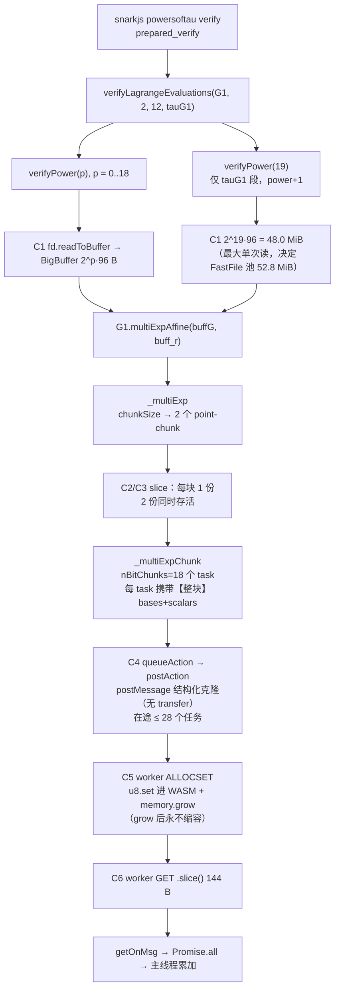
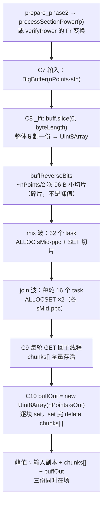

# M5 内存归因：探针设计与源码分配路径审计（M5-A）

- **状态**：设计评审稿（M5-A 交付物）。评审通过后才进入 M5-B 实现。
- **分支**：`experiment/m5-attribution`（未合入 `main`，等评审）。
- **基线**：`main @ 24a0dd3`；`ffjavascript 0.3.1`、`snarkjs 0.7.6`、`Node v22.22.2`、Windows、28 逻辑核。
- **本文件不含**：任何依赖改动、任何计算逻辑改动、任何新的实验数据。
- **配套工具**：`scripts/m5_budget.cjs`（纯静态算术，不插桩、不启动 snarkjs，用于复算本文件的账本）。

> 一句话定位：M4.1 测到的是"阶段区间内 Working Set 涨了 2.2 GiB"；M5 要把它拆成"哪一次分配、多少字节、活到什么时候"。
> 本文件先把源码里**必然发生**的复制点定死，再给出可被证伪的字节预算，最后定义能证实/推翻它的探针。

---

## 0. 结论摘要（给评审的 6 条）

1. **峰值不是"某一次大分配"，而是"并发度 × 单任务载荷"的乘积。** `verifyPower(19)` 在 p18 上把
   `2^19` 个 G1 点切成 2 个 point-chunk × 18 个 bit-chunk 任务；每个 bit-chunk 任务**各自携带整块**
   bases+scalars。单任务 41.2 MiB，首波 28 个任务同时在途 → 约 **970 MiB** 在途克隆载荷。
2. **每条 Worker 消息都是真复制**：`_multiExpChunk` / `_fft` 调 `queueAction(task)` 时**没有** transfer list，
   走结构化克隆；整条路径上唯一的 transfer 是启动时每个 Worker 的 wasm 模块字节。
3. **每个 Worker 的 WASM 线性内存约为"首块分配"的 2 倍，且永不归还**：`threadman_thread.js:49` 的扩容判据
   在 `u32[0]` 已自增后再加一次 `length`，等价于要求 `byteLength ≥ top + 2·length`。p18 的 tauG1 MSM 下
   28 个 Worker 的线性内存**容量**合计 **1455 MiB**（容量 ≠ 驻留，须与 WS 对照），任务结束后只回滚
   分配指针，不缩容。
4. **原 H1（FFT 输入副本 `buff.slice`）在 `prepared_verify @ p18` 上只有约 2%**：Fr FFT 的在途 16 MiB +
   输入副本 16.8 MiB + 输出 16.8 MiB ≈ **50 MiB**，对比 MSM 的 970 + 1455 MiB。**M4 §5 把 H1 列在候选
   首位，是基于"未归因"的合理猜测，本次审计把它降级。**（`prepare_phase2` 是另一条曲线，FFT 在那里才是
   主路径，见 §4.3。）
5. **FastFile 仍是 ≤ 1.5%**（52.8 MiB），维持 M4.1 结论，M5 只作为对照行。
6. **模型对 p18 tauG1 段 +2.2 GiB 的解释度约 98%**：扣除 phase-1 已支付的 223 MiB Worker WASM 存量后，
   模型段增量 = 在途 970 +（1455 − 223）= **2200 MiB**，对照实测 +2160 MiB（1.02×）。但**偏差是单向偏高的**：
   p16 段增量高估 2.3×，两个 power 的绝对峰分别高出实测 502 / 818 MiB。**所以 970 与 1455 是上界，不是实测值**；
   探针要做的正是把它们逐项落实（`task_send.inflight` 时间序列、28 个 Worker 的 `wasm_bytes` 末态）。
   p18 的 2% 吻合不能当作"模型已验证"——它是两项误差相加抵消的结果。

---

## 1. 审计方法与可复核性

逐文件逐行读 `node_modules/ffjavascript`（0.3.1）与 `node_modules/snarkjs`（0.7.6）的**实际安装内容**，
而不是上游 README 或浏览器端行为。下表每条事实都可 `Read` 到对应行。

| 编号 | 位置 | 事实 | 后果 |
| --- | --- | --- | --- |
| F1 | `threadman.js:21` | `MEM_SIZE = 25` 页（1.6 MiB） | 每个 Worker 初始线性内存很小，第一次大 ALLOCSET 必然触发 `memory.grow` |
| F2 | `threadman.js:104-119` | `concurrency = os.cpus().length`，上限 64 | 本机 = **28**，即 28 个 Worker、28 份独立 WASM 内存 |
| F3 | `threadman_thread.js:4` | `MAXMEM = 32767` 页 | 单 Worker 上限 2 GiB；p21 量级仍在限内 |
| F4 | `threadman_thread.js:44-56` | `alloc()` 扩容判据写成 `u32[0] + length > byteLength`，而 `u32[0]` 已 `+= length` | 实际要求 `byteLength ≥ top + 2·length` → 单 Worker 容量 ≈ 2×首块 |
| F5 | `threadman_thread.js:86-87`、`58-62` | `ALLOCSET` = `alloc` + `u8.set(整个 buffer)` | 消息克隆之外，**再**复制一份进 WASM |
| F6 | `threadman_thread.js:108-110` | `GET` 用 `.slice()` 从 WASM 拷出 | 每次任务一个 144 B 的 G1 结果（可忽略，但要证明可忽略） |
| F7 | `threadman_thread.js:115-117` | 任务结束只 `u32b[0] = oldAlloc` | 内存不缩容；Worker 的 WASM 是**单调高水位** |
| F8 | `threadman.js:196-213` | `queueAction` → `processWorks` → `postAction`，`transfers` 参数未传 | 点数据走结构化克隆，不是转移 |
| F9 | `threadman.js:121-140` | 启动时 `postAction(..., [copyCode.buffer])` | 全路径**唯一**的 transfer list |
| F10 | `engine_multiexp.js:3-8`、`119-120` | `pTSizes[log2(nPoints)]` 决定 bit-chunk；`nChunks = floor((256-1)/bitChunk)+1` | p18 时 bit-chunk = 15（`2^19` 点）→ **18 个任务/块**，载荷放大 18× |
| F11 | `engine_multiexp.js:122-125` | `chunkSize = floor(nPoints / (concurrency / nChunks))`，钳在 `[2^10, 2^22]` | 本机 28/18 ≈ 1.56 → **只有 2 个 point-chunk**，单块极大 |
| F12 | `engine_multiexp.js:131-132` | `buffBases.slice()` / `buffScalars.slice()` | 每块 1 次真复制；**所有 bit-chunk 任务共享同一份 slice**（不是 18 份） |
| F13 | `engine_fft.js:73` | `buff = buff.slice(0, buff.byteLength)` | 整体输入复制一份；`BigBuffer.slice` 在 <1 GiB 时返回 `Uint8Array` 副本（`bigbuffer.js:16-25`） |
| F14 | `engine_fft.js:109-115` | `MAX_BITS_THREAD = 14`，且 `while (nChunks < concurrency)` 继续二分 | p18 时 32 chunk × 8192 点；任务数 ≈ 112 |
| F15 | `engine_fft.js:225-228` | 因 F13 后 `buff` 已不是 `BigBuffer`，输出恒为 `Uint8Array` | 忽略 F13 的实现会误判输出类型与峰值 |
| F16 | `engine_batchconvert.js:12,28` | 固定切 `concurrency` 份 | 28 份小载荷，量级温和 |
| F17 | `web-worker 1.2.0 / cjs/node.js:168-170` | `postMessage` 直通 `worker_threads` | 克隆在**发送端同步**序列化，worker 端再反序列化 → 同一载荷短暂存在两份 |
| F18 | `web-worker / cjs/node.js:222-227` | worker 源码走 `VM.runInThisContext` | Worker 里**没有**模块作用域的 `require`，但有 `process`/`Buffer`/`WebAssembly`；遥测只能走 `postMessage` 回传 |

**两条由此确立的设计约束**：

- Worker 探针代码必须写在 `threadman_thread.js` 的 `thread()` **函数体内**——该函数被 `thread.toString()`
  序列化成 data URL 送进 Worker（`threadman.js:43`），闭包外的任何 helper 都不会跟过去。
- Worker 侧不能写文件；遥测必须随计算结果一起回传，由主线程落盘。

---

## 2. 分配路径图

### 2.1 MSM 路径（`prepared_verify` 的主热点）



### 2.2 FFT 路径（`prepare_phase2` 的主路径；在 `prepared_verify` 里只是配角）



### 2.3 四类内存的归属

| 层 | 归属 | 是否随任务结束释放 | M5 观测口径 |
| --- | --- | --- | --- |
| JS 活跃缓冲（C1/C2/C3/C7/C8/C10） | 主线程 ArrayBuffer | 逻辑上立即，物理上看 GC | `process.memoryUsage().arrayBuffers`（主线程）+ 探针记账 |
| 消息克隆（C4） | 主线程序列化副本 + Worker 反序列化副本 | 任务完成即不可达 | 探针按 task 记账（`clone_bytes`、在途计数） |
| WASM 线性内存（C5） | 每个 Worker 独立 `WebAssembly.Memory` | **否**（单调高水位） | Worker 自报 `memory.buffer.byteLength` |
| FastFile 页池 | 主线程 | fd 关闭时 | M4.1 已测，本次仅对照 |

---

## 3. 复制点清单（C1–C10）

探针事件用这套编号做 `site` 字段，便于把"账本行"与"实测行"一一对齐。

| ID | 位置 | 复制内容 | 字节（p18 `prepared_verify`） | 逻辑寿命 |
| --- | --- | --- | --- | --- |
| C1 | `powersoftau_verify.js:443-449` | 文件 → `BigBuffer` | 48.0 MiB（`2^19·96`） | 单次 `verifyPower` |
| C2 | `engine_multiexp.js:131` | bases slice | 30.9 / 17.1 MiB（两块） | 到 `Promise.all` 完成 |
| C3 | `engine_multiexp.js:132` | scalars slice | 10.3 / 5.7 MiB（两块） | 同上 |
| C4 | `threadman.js:186` → `worker_threads` | 结构化克隆 | 41.2 / 22.9 MiB × 18 次/块 | 单任务 |
| C5 | `threadman_thread.js:87,58-62` | 克隆 → WASM 线性内存 | 同上（另加 grow 余量） | **到进程结束** |
| C6 | `threadman_thread.js:109` | WASM → 144 B `Uint8Array` | 144 B × 36 | 单任务 |
| C7 | `powersoftau_verify.js:454-474` | `buff_r` 重建 + 3 次变换输出 | 16.8 MiB × 4 轮 | 单次 `verifyPower` |
| C8 | `engine_fft.js:73` | FFT 整体输入复制 | 16.8 MiB（Fr）/ 50.3 MiB（G1 ifft @2^19） | 单次 `_fft` |
| C9 | `engine_fft.js:123-148,170-205` | 分片收发 | mix 在途 16 MiB；join 每轮 ≤ 72 MiB | 单波 |
| C10 | `engine_fft.js:225-245` | 输出缓冲 + 逐块 `set` | 16.8 MiB（Fr）/ 50.3 MiB（G1） | 单次 `_fft` |

---

## 4. 字节公式与静态账本（模型，非测量）

`scripts/m5_budget.cjs` 把上述算术完整复现，可自行复算：

```
node scripts/m5_budget.cjs --power 18 --operation prepared_verify
node scripts/m5_budget.cjs --power 18 --operation prepare_phase2
```

### 4.1 MSM 的两个乘数（关键）

设 `N` = 点数，`s` = 标量字节（32），`sG` = 仿射点字节（96）：

- `bitChunk = pTSizes[floor(log2 N)]`，`nBitChunks = floor((8s-1)/bitChunk)+1`
- `chunkSize = floor(N / (concurrency / nBitChunks))`，钳在 `[2^10, 2^22]`
- **单任务载荷** `= chunkSize · (sG + s)`；**克隆总量** `= nBitChunks · N · (sG+s)`，**与并发度无关**
- **在途峰值** `≈ min(concurrency, 任务数) · 单任务载荷`
- **Worker WASM 合计** `≈ Σ_worker (2·首块 + 其余)`（F4 的双倍余量）

由此得到两条与直觉相反的结论：

1. **克隆总量只由 `nBitChunks` 决定**——p18 tauG1 为 `18 × 64 MiB ≈ 1152 MiB`，改并发度**不会**减少总量，
   只减少同时在途量。
2. **并发度是唯一同时压低"在途"和"WASM 驻留"的旋钮**，但**不是单调的**——并发度越低，`chunkSize`
   越大（`c=16` 时整域只剩 1 块 2^19 点），单任务载荷也随之变大。p18 tauG1 的模型绝对值（在途 + WASM）：

   | concurrency | 4 | 8 | 16 | 28 |
   | --- | ---: | ---: | ---: | ---: |
   | 在途 | 256 | 512 | 1024 | 970 |
   | Worker WASM | 384 | 768 | 1537 | 1455 |
   | 合计 | **640** | **1280** | **2561** | **2425** |

   `c=16` 反而比 `c=28` 更差，因为 1 块 2^19 点让每个 Worker 的 2× 余量作用在 48 MiB 上。
   存在一个内部最优点（本例落在 c≈8–12）。**这是 M6 的输入，不是 M5 的动作**；M5 只负责让探针
   能验证这张表。

### 4.2 账本：`prepared_verify`

| 项 | p16 | p18 |
| --- | ---: | ---: |
| tauG1 MSM 点数 | `2^17` | `2^19` |
| `bitChunk` 位宽 / point-chunk 数 | 13 位 / 2 块 | 15 位 / 2 块 |
| 任务数（块×位） | 20 × 2 = 40 | 18 × 2 = 36 |
| 单任务载荷 | 11.4 + 4.6 MiB | 41.2 + 22.9 MiB |
| 克隆总量 | 320 MiB | 1152 MiB |
| **在途峰值** | **265 MiB** | **970 MiB** |
| **Worker WASM 合计** | **399 MiB** | **1455 MiB** |
| lagrange MSM 在途 / WASM | 133 / 200 MiB | 505 / 759 MiB |
| Fr FFT 在途 / WASM | 4 / 44 MiB | 16 / 44 MiB |
| FastFile 池 | 13.2 MiB | 52.8 MiB |
| **模型共存峰值（tauG1 时刻）** | **≈ 1.1 GiB** | **≈ 2.9 GiB** |

> 上表的 WASM 列是**绝对高水位**。其中 223 MiB 在 phase-1 就已支付（见 §4.4），所以 phase-2 的增量
> 应扣掉这部分；表末的"共存峰值"是含进程基础（~430 MiB）的绝对量，两者不要混用。
> 表内也**不含** `buffG`（48 MiB）、`buff_r`（16.8 MiB）等逐个 power 重建的缓冲，它们计入 §4.4 的残差。
> 该行口径固定为：`430 + tauG1 在途 + tauG1 WASM + Fr FFT 在途 + FFT WASM + FastFile 页池`
> （p16：430+265+399+4+44+13 = **1155 MiB**；p18：430+969+1455+16+44+53 = **2966 MiB**）。
> 相位假设是"tauG1 大 MSM 独占时刻"——`verifyLagrangeEvaluations` 对 tauG1 的 `2^(p+1)` 那次 MSM
> 发生在所有 `2^p` 小 MSM 之后，因此**不与 lagrange 段叠加**；lagrange 的在途 133/505 MiB 只出现在
> 更早的相位，不进入这一行。

### 4.3 账本：`prepare_phase2`（对照，不同操作）

| 项 | p16 | p18 |
| --- | ---: | ---: |
| 最大 ifft（`2^(p+1)` 点） | `2^17` | `2^19` |
| 在途收发 | 18 / 18 MiB | 72 / 72 MiB |
| Worker WASM 合计 | 49 MiB | 191 MiB |
| JS 装配（C8 副本 + chunks[] + C10 输出） | 42 MiB | 168 MiB |
| 模型合计 | ≈ 110 MiB | ≈ 430 MiB |
| M3 实测 peak WS | 1029 MiB | 1610 MiB |
| **残差** | **≈ 920 MiB** | **≈ 1180 MiB** |

> 这张表是 M5 最值得注意的地方：`prepare_phase2` 的实测峰值**远大于**源码级模型的账本。说明该操作的
> 峰值主要不是"单次分配"，而是 20 个 power 反复分配/丢弃大缓冲导致的驻留与碎片。这正是必须测
> `arrayBuffers`（外部内存）而不只是 WASM 的原因。
> 注意实测列取自 M3 的**单次**运行（`prepare_phase2` 未进 M4 重复基线），未量化会话漂移；
> 作对照用可以，不能当作精确靶值。

### 4.4 模型 vs 实测（`prepared_verify`）

比较前必须先扣除**已经在账上的存量**：phase-1 的 `processSection` 也跑 MSM（每次 65535 点、22 个 bit-chunk、
2 个 point-chunk），它已经把 28 个 Worker 的线性内存抬到 **223 MiB**（模型值，单任务 6.3 MiB × 2 余量）。
因此 phase-2 的**增量**是 `在途 + (WASM_after − 223)`，而不是 `在途 + WASM_after`。

| 量 | p16 | p18 |
| --- | ---: | ---: |
| M4.1 实测 peak WS（3 次中位数 / 均值） | 1631 / 1657 MiB | 3738 / 3784 MiB |
| phase-2 起始标记处 current WS | 1035 MiB | 776 MiB |
| **实测** tauG1 段增量（到 tauG2 标记） | **+194 MiB** | **+2160 MiB** |
| 模型在途峰值 | 265 MiB | 970 MiB |
| 模型 WASM 增量（398.8 / 1454.6 − 223） | +176 MiB | +1231 MiB |
| **模型** tauG1 段增量 | **+441 MiB** | **+2200 MiB** |
| 模型 / 实测 | 2.3× | **1.02×** |
| 模型共存峰值（§4.2 口径，含 430 MiB 基础） | 1155 MiB | 2966 MiB |
| 实测绝对峰 − 模型共存 | **−502 MiB** | **−818 MiB** |

两条读法：

- **p18 的段增量吻合到 2%**——这正好是 RQ4 问的那 2.2 GiB，模型把它几乎完全归到"克隆在途 + WASM 扩容"。
  这是"M5 值得做"的理由：解释项已经定位到两个具体机制，而不是笼统的"内存碎片"。
- **模型的偏差是单向的，全部偏高**：p16 段增量高估 2.3×（441 vs 194），两个 power 的绝对峰分别高出实测
  0.5 / 0.8 GiB。所以这个模型的身份是**上界**，不是估计量。p18 的 2% 吻合因此有一半是巧合——在途与 WASM
  两项各自都可能偏，只是加起来对上了。**探针的价值就是把这 2% 从"两个偏差互相抵消"变成"逐项对账"**；
  在拿到逐项数据之前，不要对外引用 970 / 1455 这两个数，只能引用"M5 有两个待验证机制"。

### 4.5 外推（未测量，仅作风险提示）

| power | tauG1 MSM 在途 | Worker WASM | 模型共存 |
| --- | ---: | ---: | ---: |
| 19 | 1829 MiB | 2744 MiB | ≈ 4.9 GiB |
| 20 | 3657 MiB | 5487 MiB | ≈ 9.5 GiB |
| 21 | 7314 MiB | 10972 MiB | ≈ 18 GiB |

> 这是**模型上界**（假设 28 个 Worker 同时持有整块克隆且全部扩容到位），不是运行预测，也**不进入任何
> 结论**。它只说明一件事：`prepared_verify` 的内存是 `O(N·nBitChunks)` 且被并发度线性放大，p20 以上
> 在本机（31.7 GiB）会进入危险区。M5 不跑 p20/p21，冻结线不变。
>
> 与 M3 的关系要写清：M3 报告里那个"p21 15–25 GiB"的估算**已按要求撤回**（它的乘数没有源码依据）；
> 本表用的是 M5-A 刚核对过的 `nBitChunks × N × 128 B` 与 `2× ALLOCSET` 两条机制，**在 p18 上与实测
> 段增量吻合到 2%**，因此可以重新给出量级。但"p18 吻合"不等于"p21 可信"——同一模型在 p16 上就偏了 2.3×。
> **本表只能用于风险提示，任何文档不得把它当预测值引用；要报 p19+ 的数，必须实测。**

---

## 5. 可检验假设（H-A … H-D）

| 假设 | 内容 | 判定证据 | 推翻条件 |
| --- | --- | --- | --- |
| **H-A** | p18 tauG1 段的增长主要来自 MSM 克隆在途（≥ 800 MiB） | 探针在途字节时间序列的峰 ≥ 800 MiB，且与 WS 上升同相位 | 在途峰 < 500 MiB |
| **H-B** | 每个 Worker 的 WASM 容量 ≈ 2× 首块，且任务结束后不回落 | 28 个 Worker 的 `wasm_bytes` 稳态 ≥ 2×最大 ALLOCSET | 稳态 ≈ 1×（说明 F4 读错） |
| **H-C** | FFT 与 FastFile 合计 < 150 MiB（p18 `prepared_verify`） | C8–C10 记账 + 页池快照 | 合计 > 300 MiB |

对 `prepare_phase2` 另设 **H-D**：其峰值主体是"重复分配未及时回收"（`arrayBuffers` 高水位 ≫ 探针记账的在途量），
而不是任何单次大分配。

---

## 6. 探针设计（M5-B 规格）

### 6.1 形态与开关

- **不修改 `node_modules`**。用 `npm pack ffjavascript@0.3.1` 取固定 tarball（记录 sha256），解到
  `vendor/ffjavascript-0.3.1-m5/`，在**该副本**上打 `patches/m5-instrumentation.patch`
  （vendor 目录、patch、hook 三者均为 **M5-B 产出**，本文件只定规格）。
- 用 `scripts/m5_resolve_hook.cjs`（`Module._resolveFilename` 重定向 `ffjavascript` → 副本）注入，
  与 M4 的 `--require` 机制一致，`node_modules` 保持出厂状态，可随时 `git status` 证明未被污染。
- 开关：`M5_TRACE=1` 才激活；`M5_OUT=<path>.jsonl` 指定输出；两者都缺省时走与原版**相同的代码路径、
  相同的返回值形状**（所有探针分支都在 `if (!M5_ON) return;` 之后，不新增 await、不改任务顺序）。
- 输出物：`results/raw/m5_<op>_p<power>_r<n>.jsonl`（**不提交**，与 M3/M4 raw 同策略）。
- Worker 内的开关同样读 `process.env.M5_TRACE`：`worker_threads` 默认继承父进程环境变量，不必额外传参；
  但 `M5_OUT` 在 Worker 里**无效**（Worker 无 `fs`），只由主线程消费。

### 6.2 遥测通道（避免打断原有 Promise 协议）

Worker 现有协议是 `self.postMessage(ctx.out)`，主线程 `getOnMsg` 直接 `resolve(data)`，调用方按 `r[0]` 取值。
**若额外 `postMessage` 一条遥测，会被 `getOnMsg` 当成任务完成而提前 resolve**——必须避免。

设计：payload 改成一个**只在开启时**出现的包装对象，解包只发生在 `getOnMsg` 一处：

```js
// threadman.js:145-158, getOnMsg(i)（现有四行 + 我们的三行）
let payload = data;
if (payload && payload.__m5) {          // 仅 M5_TRACE=1 时存在
    tm.m5.ingest(payload.__m5, i);      // 主线程落盘（worker 内无 fs）
    payload = payload.out;              // 对外形状与 ctx.out 完全一致
}
tm.working[i] = false;
tm.pendingDeferreds[i].resolve(payload);
tm.processWorks();
```

Worker 侧（`threadman_thread.js:17-25` 走的正是 `self.postMessage(runTask(data))`）：

```js
// threadman_thread.js, runTask() 末尾
const out = ctx.out;
return M5_ON ? { __m5: snapshot, out } : out;   // 关闭时返回原数组，零差异
```

`_multiExpChunk` / `_fft` / `_batchConvert` 一行都不用改——它们看到的仍是数组。

**关联**：`postAction` 里分配 `taskId` 并记进 `tm.m5.inflightTask[workerId]`（**不要**挂在 Promise 对象上），
`getOnMsg` 用它把 worker 的 `__m5` 与主线程记的 `send_bytes` 对齐。载荷字节数在 `postAction` 里按
`ALLOCSET`/`SET` 的 `buff.byteLength` 求和即可（O(命令数)，不碰数组原型）。

### 6.3 事件模型（JSONL）

首行是时间锚点，供与 PowerShell 的 `[t=NNNms]` 对齐：

```json
{"ev":"anchor","epoch_ms":1762500000000,"hr_ns":123456789,"concurrency":28,"node":"v22.22.2"}
```

| 事件 | 触发点 | 关键字段 |
| --- | --- | --- |
| `msm_plan` | `_multiExp` 入口 | `op,p,n_points,bit_chunk,n_bit,n_point_chunk,chunk_pts[],slice_bytes,site` |
| `fft_plan` | `_fft` 入口 | `op,p,n_points,bits,points_in_chunk,n_chunks,copy_bytes` |
| `task_send` | `postAction` | `task_id,worker,site,send_bytes,inflight,queue_depth,ts` |
| `task_done` | `getOnMsg` | `task_id,worker,svc_ms,inflight_after` |
| `worker_task` | worker `runTask` 末尾 | `worker,task_cmd,wasm_before,wasm_after,grow_pages,grows,alloc_top,alloc_high_water,allocset_bytes,get_bytes,w_heap_used,w_external,w_array_buffers` |
| `heap_sample` | 主线程 200 ms 定时 | `rss,heap_used,external,array_buffers` |
| `fft_assembly` | `_fft` 末尾 | `copy_bytes,chunks_bytes,out_bytes,sum_bytes` |

字段口径（容易搞错的四条）：

- `worker.wasm_bytes` 是**容量**（`memory.buffer.byteLength`），不是驻留字节；它只能与 Peak Working Set
  做"包含关系"比较，**不能相加**。
- 主线程 `arrayBuffers` 已包含在 `external` 内，**不可累计**；`rss` 是整进程值（含所有 Worker）。
- Worker 侧的 `w_heap_used / w_external / w_array_buffers` 是**该 isolate 自己的**值，而 worker 里的
  `rss` 是整进程值——所以 Worker 只上报堆字段，进程级 RSS 统一由主线程采一次，避免把同一份 RSS 抄 28 遍。
- `send_bytes` 是**单份**逻辑载荷；序列化副本与 worker 反序列化副本是同一份载荷的两个瞬间，入库时用
  `send_bytes` 一次，另用 `inflight` 描述重叠，不做 2× 相乘，避免重复计数。

### 6.4 采样与聚合

- 事件按任务/计划粒度触发（p18 一轮 112 个 `task_send` + 112 个 `worker_task`），**不在分配循环里打点**。
- 主线程缓存在数组里，每 256 条或 250 ms 落盘一次；`process.on('exit')` 兜底 flush。
- 禁止：`Uint8Array.prototype.slice` 全局劫持、每秒级 `Object.keys` 扫描、在 `alloc()` 内部写日志。
  （M4 的教训：O(pages) 的探针让 p16 从 10 s 变成 18 s。）

### 6.5 扰动预算（M5-C 的验收项）

| 指标 | 门槛 |
| --- | --- |
| 墙钟时间膨胀 | ≤ 10%（对照 M4.1 同 power 均值） |
| peak WS 偏移 | ≤ M4.1 会话内 CV（p18 2.5%，p16 3.9%） |
| 事件完整性 | `task_send` 数 == `worker_task` 数；无 taskId 丢失 |
| 语义不变 | `prepared_verify` 退出码 0，输出 `Powers of Tau Ok!` |
| 关闭态等价 | `M5_TRACE` 未设时，`results/raw` 的 peak WS 落在 M4.1 区间内 |

### 6.6 明令禁止（M5 全程）

- 不改 `chunkSize` / `pTSizes` / `concurrency` / 任务顺序 / `Promise.all` 结构。
- 不引入 transfer list（那会改变内存语义，属于 M6 的假设，不是 M5 的观测）。
- 不对 F4 的 `alloc()` 双倍余量做"顺手修复"——**只测量它的后果**，修复须单独立项评审。
- 不跑 p20/p21；不动 `m1-m2-frozen`。

---

## 7. 测量协议（M5-C / M5-D）

**M5-C（smoke，Power 10）**

1. `M5_TRACE=1` 跑 `prepared_verify @ p10`，验证：退出码 0、JSONL 可解析、`concurrency=28`、
   `task_send`/`worker_task` 配平、`msm_plan` 的 `chunk_pts` 与 `m5_budget.cjs` 的预测逐字段相等。
2. 关掉探针再跑一次，比较 peak WS 与耗时（扰动预算）。
3. 断言 worker 侧收到的 task 数组**没有**被探针附加的属性（结构化克隆对 Array 只复制索引）。

**M5-D（p16 / p18 正式归因）**

- fixture、版本、`PollIntervalMs=25`、FastFile 采样全部沿用 M4.1，不做任何"顺手改进"。
- **交错对照**：`on, off, on, off, on, off`（每 power ≥ 3 对），用于抵消会话漂移（M4.1 已观察到 +3.9%）。
- 每对之间保持相同等待与相同磁盘状态（同一 fixture 只读）。
- 产出：`m5_attribution_p16|p18.{csv,md}` + 一张"四类 × 阶段"的堆叠图；原始 JSONL 不入库。

---

## 8. 研究问题 → 证据映射

| 问题 | 回答它的字段 | 判定方式 |
| --- | --- | --- |
| RQ1 FFT 输入副本与分片是否峰值主要贡献者 | `fft_plan.copy_bytes`、`fft_assembly.*`、C8–C10 记账 | 与 MSM 在途同图比较；H-C |
| RQ2 MSM 分片与 Worker 克隆实际同时存活多少 | `task_send.send_bytes` + `inflight` 时间序列 | 在途峰 vs 970 MiB 预测；H-A |
| RQ3 各 Worker WASM 是否持续增长并保留 | `worker_task.wasm_before/after`、`grow_pages`、`grows` | 28 个 Worker 的末态容量；H-B |
| RQ4 p18 tauG1 的 +2.2 GiB 由什么解释 | 上述三者的同相位叠加 + `heap_sample.array_buffers` 残差 | 残差 ≤ 15% 视为可解释 |

---

## 9. 风险与边界

1. **模型不是测量**。§4 所有数字都是"源码算术 + 假设"，只有 §7 的协议跑完才有结论权。
2. **克隆的两份副本**（F17）在时间上高度重叠但极短，采样探针可能永远采不到 2× 的瞬间；这不算失败，
   应在报告里明确"我们测量的是载荷总量与在途计数，不是瞬时物理双份"。
3. **V8 的 ArrayBuffer 回收不可观测**。`arrayBuffers` 只能给"当前持有量"，给不出"何时释放"；
   逻辑寿命与物理寿命的差值就是 H-D 要回答的东西，可能需要 `--expose-gc` 的手动对照跑（单列，不改主流程）。
4. **WASM 容量 ≠ 驻留**。Worker 扩容但未写满的页可能不在 WS 里；因此 H-B 只能证明"容量增长"，
   WS 贡献要靠时间相位对齐来间接支持。
5. **Windows 口径**。继续用 `PeakWorkingSet64` / `PeakPagedMemorySize64`，与 M3/M4.1 完全一致；
   不引入私有字节或 RSS 之类新口径，避免口径漂移。
6. **28 个 Worker 的遥测体积**：p18 每轮约 224 条任务事件 × 20 个 power ≈ 4.5 k 条/次，JSONL 约 1–2 MB，
   可接受；若超预期，降级为"每轮只记聚合值"。

---

## 10. 评审门与后续

- **M5-A（本文件）**：需评审确认三件事——① 两条放大机制（F4 双倍余量、F10/F11 位块放大）是否符合预期；
  ② §4 的模型是否被接受为"M5-D 的预测基线"；③ §6 的探针边界（只测不改）是否足够。
- **M5-B**：实现 patch + resolve hook + 落盘，交付 `patches/m5-instrumentation.patch` 与开关说明。
- **M5-C**：p10 smoke 通过 §6.5 五项门槛。
- **M5-D**：p16/p18 交错对照，产出归因表。
- **M5-E**：写 `docs/M5_ATTRIBUTION.md`，届时**才**讨论 H1 / MSM 并发 / 缓冲寿命三个候选的优先级。
  在此之前不写任何优化代码。
