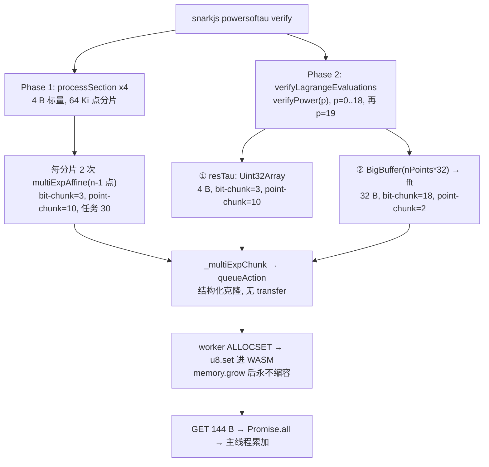
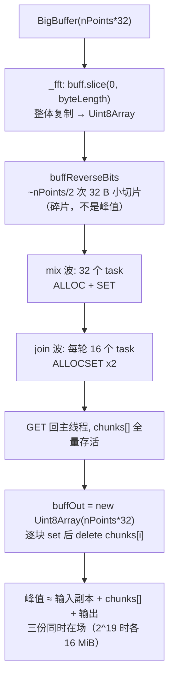

# M5 内存归因：探针设计与源码分配路径审计（M5-A.1）

- **状态**：A.1 修订稿（评审稿）。评审通过后才进入 M5-B 实现。
- **分支**：`experiment/m5-attribution`（未合入 `main`）。
- **基线**：`main @ 24a0dd3`；`ffjavascript 0.3.1`、`snarkjs 0.7.6`、`Node v22.22.2`、Windows、28 逻辑核。
- **本文件不含**：任何依赖改动、任何计算逻辑改动、任何新的实验数据。
- **配套工具**：`scripts/m5_budget.cjs`（纯静态算术，不插桩、不启动 snarkjs，用于复算本文件的账本）。

> 一句话定位：M4.1 测到的是"阶段区间内 Working Set 涨了 2.2 GiB"；M5 要把它拆成"哪一次分配、多少字节、活到什么时候"。
> 本文件先把源码里**必然发生**的复制点定死，再给出可被证伪的字节预算，最后定义能证实/推翻它的探针。

---

## 0. A.1 修订对照（相对 `e2bb900`）

| # | A 稿 | A.1 稿 | 依据 |
| --- | --- | --- | --- |
| 1 | 把 `tauG1` 的 MSM 当成一条 32 B 标量账目 | **拆成三条**：`processSection`（4 B）、`resTau`（4 B）、`resLagrange`（32 B） | `powersoftau_verify.js:361 / 425 / 454` |
| 2 | Phase 1 存量 **223 MiB**（按 32 B、22 bit-chunk、2 point-chunk） | **72.4 MiB**（4 B、3 bit-chunk、10 point-chunk，G2 段把 Worker 扩到 42 页） | `:361` + `:112-137` |
| 3 | "模型解释 98%，误差 2%" | **撤回**。改后模型段增量 2351 MiB 对实测 2160 MiB，**高出 8.9%**，仍属上界 | §5.5 |
| 4 | 用"模型共存峰值"直接减"全程峰值" | **删除该比较**（不同相位不可比）。改为同窗口锚定：起始 current WS + 模型增量 | §5.5 |
| 5 | F14 写"p18 时 32 chunk × 8192 点" | **32 chunk × 16384 点**（`2^19/2^14`）；8192 是 `2^18` 的情形 | `engine_fft.js:13` |
| 6 | MB 与 MiB 混用（16.8 / 50.3） | 全文统一 **MiB**；`2^19×32 = 16 MiB`、`2^19×96 = 48 MiB` | —— |
| 7 | `prepare_phase2` 残差解释为"碎片/未释放" | 降级为**未解释残差**，不作机制断言 | §5.4、§10.6 |
| 8 | 验收门"探针值落在模型值 70%–100%" | **删除**。改为三层：切分逐字段相等 / 逐 Worker 页数对账 / 同刻四量对比 | §7.6 |

---

## 1. 结论摘要（给评审的 6 条）

1. **must-fix 已修**：`snarkjs` 在三个地方喂不同宽度的标量——`processSection` 4 B、`resTau` 4 B、`resLagrange` 32 B。
   A 稿把 32 B 的位块放大（18 个 bit-chunk）套到了全部 MSM 上，导致 Phase 1 基线与"2% 吻合"两个结论都不成立。
2. **位块放大机制本身成立，但只对 32 B 路径成立**：p18 的 `resLagrange` 在 `2^19` 点上仍是 18 bit-chunk × 2 point-chunk
   = 36 任务、单任务 41.1 MiB、在途 969 MiB；而同一次 `verifyPower(19)` 里先跑的 `resTau`（4 B）只有 3 bit-chunk ×
   10 point-chunk = 30 任务、单任务 5.4 MiB、在途 146 MiB。
3. **Worker WASM 的双倍余量机制成立**（`alloc()` 把 `length` 加了两次），但**每个 Worker 的容量取决于它接过哪个分片**，
   所以"1455 MiB"是一个**上界**（按大分片优先分配），不是确定预测；真实值必须逐 Worker 读。
4. **Phase 1 基线重算为 72.4 MiB**，驱动项不是 G1 而是 **G2 的 `tauG2` 段**（`65535×192×2 > 25 页` → 扩到 42 页）。
   扣除后的模型段增量 = 969.1 +（1454.6 − 72.4）= **2351 MiB**，对实测 +2160 MiB **高出 8.9%**。
5. **p16 上同一模型高出 3.0×**（591 MiB 对 194 MiB）。所以这个账本的身份仍是**上界**：p18 差 9%、p16 差 200%，
   说明还有未被建模的项（或 Worker 容量远未写满）。**M5 的价值就在这里**。
6. **原 H1（FFT 输入副本）在 `prepared_verify @ p18` 上只有约 48 MiB**（16 输入副本 + 16 分片 + 16 输出），
   相对 MSM 的 969 + 1455 可忽略；`prepare_phase2` 相反，FFT 才是主路径，但它与实测的残差目前**无法解释**，
   只能说"模型漏了东西"，不能断言是碎片。

---

## 2. 审计方法与事实表

逐文件逐行读 `node_modules/ffjavascript`（0.3.1）与 `node_modules/snarkjs`（0.7.6）的**实际安装内容**。

| 编号 | 位置 | 事实 | 后果 |
| --- | --- | --- | --- |
| F1 | `threadman.js:21` | `MEM_SIZE = 25` 页（1.5625 MiB） | 首次大 ALLOCSET 必然触发 `memory.grow` |
| F2 | `threadman.js:104-119` | `concurrency = os.cpus().length`，上限 64 | 本机 = **28** 个 Worker、28 份独立线性内存 |
| F3 | `threadman_thread.js:4` | `MAXMEM = 32767` 页 | 单 Worker 上限 2 GiB |
| F4 | `threadman_thread.js:44-56` | `alloc()` 判据写成 `u32[0] + length > byteLength`，而 `u32[0]` 已 `+= length` | 实际要求 `byteLength ≥ top + 2·length` → 首个大分片使容量≈2× |
| F5 | `threadman_thread.js:58-62, 86-87` | `ALLOCSET` = `alloc` + `u8.set(整个 buffer)` | 消息克隆之外**再**复制一份进 WASM |
| F6 | `threadman_thread.js:108-110` | `GET` 用 `.slice()` 拷出 | 每次 MSM 任务一个 144 B 的 G1 结果 |
| F7 | `threadman_thread.js:115-117` | 任务结束只 `u32b[0] = oldAlloc` | 不缩容；Worker 容量是**单调高水位** |
| F8 | `threadman.js:196-213` | `queueAction` → `processWorks` → `postAction`，`transfers` 未传 | 点数据走结构化克隆 |
| F9 | `threadman.js:121-140` | 启动时 `postAction(..., [copyCode.buffer])` | 全路径**唯一**的 transfer list |
| F10 | `engine_multiexp.js:112-120` | `sScalar = floor(scalars.byteLength / nPoints)`；`bitChunk = pTSizes[log2(nPoints)]`；`nBitChunks = floor((8·sScalar−1)/bitChunk)+1` | 标量宽度**直接决定**位块数：4 B→3，32 B→18 |
| F11 | `engine_multiexp.js:122-137` | `chunkSize = floor(nPoints / (concurrency / nBitChunks))`，钳在 `[2^10, 2^22]`；每个 point-chunk 起 1 次 slice，`nBitChunks` 个任务共享它 | 位块数越大，point-chunk 越大，单任务载荷越大 |
| F12 | `engine_multiexp.js:131-132` | `buffBases.slice()` / `buffScalars.slice()` | 每块 1 次真复制（不是每任务 1 次） |
| F13 | `powersoftau_verify.js:361` | `scalars = getRandomBytes(4*(n-1))` | **Phase 1 标量是 4 B**，不是 32 B |
| F14 | `powersoftau_verify.js:371-372` | 每个 64 Ki 点分片跑**两次** MSM，各 `(n-1)` 点，顺序 await | Phase 1 的在途量按单次调用算，不相加 |
| F15 | `powersoftau_verify.js:425, 439` | `buff_r = new Uint32Array(nPoints)` 再转 `Uint8Array` | **`resTau` 标量 4 B**（`:452`） |
| F16 | `powersoftau_verify.js:454, 470-474` | `buff_r = new BigBuffer(nPoints*Fr.n8)`，经 batchToMontgomery → **fft** → batchFromMontgomery | **`resLagrange` 标量 32 B**（`:482`），且同一次迭代内还有一次全域 FFT |
| F17 | `engine_fft.js:13, 109-115` | `MAX_BITS_THREAD = 14`，且 `while (nChunks < concurrency)` 继续二分 | `2^19` → **32×16384**；`2^18` → 32×8192；`2^17` → 32×4096 |
| F18 | `engine_fft.js:73` | `buff = buff.slice(0, buff.byteLength)` | 整体输入复制一份；< 1 GiB 时 `BigBuffer.slice` 返回 `Uint8Array` 副本 |
| F19 | `web-worker 1.2.0 / cjs/node.js:168-170, 222-227` | `postMessage` 直通 `worker_threads`；worker 源码走 `VM.runInThisContext` | 克隆在发送端序列化；Worker 内无模块级 `require`，但有 `process`/`WebAssembly` |
| F20 | `threadman_thread.js:8-22` | **未实测**：模块初始化后 `u32[0]` 的静态数据基址 | 本文件所有容量按基址 = 0 计算，须由 M5-B 读真值 |

**两条设计约束**（由 F19 推出）：

- Worker 探针必须写在 `threadman_thread.js` 的 `thread()` **函数体内**——该函数被 `thread.toString()` 序列化成
  data URL 送进 Worker（`threadman.js:43`），闭包外的 helper 不会跟过去。
- Worker 侧不能写文件；遥测必须随计算结果一起回传，由主线程落盘。

---

## 3. 三条独立账目（A.1 的核心结构变更）

| 账目 | 源码 | 标量宽度 | 点数 | 典型位块数（p18 最大迭代） | 何时发生 |
| --- | --- | ---: | --- | ---: | --- |
| **A 阶段 1** | `processSection`（`:340-396`） | **4 B** | 每分片 65536，MSM 用 `n-1` | **3** | Phase 1，四个 section |
| **B `resTau`** | `verifyPower`（`:425-452`） | **4 B** | `2^p` | **3** | 每次 `verifyPower` 的第一步 |
| **C `resLagrange`** | `verifyPower`（`:454-482`） | **32 B** | `2^p` | **18**（p=19） | 同一 `verifyPower` 的第二步，FFT 之后 |

**A 稿的错误就是把 C 的参数用在了 A 和 B 上。** 三者不可合并：位块数差 6 倍，point-chunk 数与单任务载荷全部不同。

### 3.1 MSM 路径（按账目分支）



### 3.2 FFT 路径（`resLagrange` 前置；`prepare_phase2` 的主路径）



---

## 4. 复制点清单（C1–C11）

探针事件用这套编号做 `site` 字段。

| ID | 位置 | 复制内容 | 字节（p18 `prepared_verify`） | 逻辑寿命 |
| --- | --- | --- | --- | --- |
| C1 | `powersoftau_verify.js:443-449` | 文件 → `BigBuffer buffG` | 48 MiB（`2^19·96`） | 单次 `verifyPower`（**两次 MSM 复用同一份**） |
| C2 | `engine_multiexp.js:131` | bases slice | 30.9 / 17.1 MiB（`resLagrange` 两块） | 到 `Promise.all` 完成 |
| C3 | `engine_multiexp.js:132` | scalars slice | 10.3 / 5.7 MiB（同上） | 同上 |
| C4 | `threadman.js:186` → `worker_threads` | 结构化克隆 | 41.1 / 22.9 MiB × 18 次/块 | 单任务 |
| C5 | `threadman_thread.js:58-62` | 克隆 → WASM 线性内存 | 同上（另加 grow 余量） | **到进程结束** |
| C6 | `threadman_thread.js:108-110` | WASM → 144 B `Uint8Array` | 144 B × 36 | 单任务 |
| C7 | `powersoftau_verify.js:425` | `resTau` 标量 `Uint32Array` | 2 MiB（`2^19·4`） | 单次 `verifyPower` |
| C8 | `powersoftau_verify.js:454` | `resLagrange` 标量 `BigBuffer` | 16 MiB（`2^19·32`） | 单次 `verifyPower` |
| C9 | `engine_fft.js:73` | FFT 整体输入复制 | 16 MiB | 单次 `_fft` |
| C10 | `engine_fft.js:123-148, 170-205` | FFT 分片收发 | mix 在途 16 MiB；join 每轮 ≤ 16 MiB | 单波 |
| C11 | `engine_fft.js:225-245` | FFT 输出缓冲 + 逐块 `set` | 16 MiB | 单次 `_fft` |

> 单位口径：`2^19×32 B = 16,777,216 B ≡ 16 MiB`；`2^19×96 B = 50,331,648 B ≡ 48 MiB`。
> A 稿里的 "16.8 MiB / 50.3 MiB" 是把十进制 MB 混进了 MiB 列，已全部改正。

---

## 5. 静态账本（模型，非测量）

`scripts/m5_budget.cjs` 复现全部算术：

```
node scripts/m5_budget.cjs --power 18 --operation prepared_verify
node scripts/m5_budget.cjs --power 18 --operation phase1
node scripts/m5_budget.cjs --power 18 --operation prepare_phase2 --json
```

**两个必须在读数字前接受的假设**：

- **HYP-1**：Worker 初始化后 `u32[0]` 基址取 **0**（F20 未实测）。真实基址只会把容量再抬整页，方向已知。
- **HYP-2**：Worker 容量总和按"大分片优先分配到不同 Worker"计算，是**上界**。实际分配取决于调度顺序
  （36 个任务 / 28 个 Worker 时，18 个大任务必然落在 18 个不同 Worker，其余 10 个任务可能复用已扩容的 Worker）。
  因此真实值落在"只有 18 个大分片 Worker 被扩容"与"28 个全部扩容"之间。

### 5.1 账目 A：Phase 1（4 B 标量）

| section | 群 | 点数 | 64 Ki 分片 | MSM 点数 | bitChunk | 位块数 | point-chunk | 任务数 | 单任务 MiB | 在途 MiB | Worker 页 |
| --- | --- | ---: | ---: | ---: | ---: | ---: | ---: | ---: | ---: | ---: | ---: |
| tauG1 | G1 | 524287 | 8 | 65535 | 12 | 3 | 10 | 30 | 0.7 | 18.3 | 25 |
| **tauG2** | **G2** | 262144 | 4 | 65535 | 12 | 3 | 10 | 30 | 1.3 | 35.9 | **42** |
| alphatauG1 | G1 | 262144 | 4 | 65535 | 12 | 3 | 10 | 30 | 0.7 | 18.3 | 25 |
| betatauG1 | G1 | 262144 | 4 | 65535 | 12 | 3 | 10 | 30 | 0.7 | 18.3 | 25 |

- G1 分片 `7021×96×2 = 1,348,032 B < 25 页` → **不扩容**，Worker 停在 25 页。
- G2 分片 `7021×192×2 = 2,696,064 B > 25 页` → 扩到 `floor(2,696,064/65536)+1 = 42` 页 = 2.625 MiB。
- 尾部小分片（2346 点）不扩容，所以最终 **27 个 Worker @42 页 + 1 个 @25 页**：

  `27 × 2.625 + 1 × 1.5625 = 72.4 MiB`  ← **Phase 1 基线（替代 A 稿的 223 MiB）**

> 这是 A 稿最实质的错误：223 MiB 建立在"22 个位块、2 个 point-chunk"上。4 B 标量只有 3 个位块、10 个
> point-chunk，单任务从 41 MiB 降到 1.3 MiB，扩容后的容量自然只有 42 页。

### 5.2 账目 B：`resTau`（4 B）

| p | 点数 | bitChunk | 位块数 | point-chunk | 任务数 | 单任务 MiB | 在途 MiB | Worker 页 |
| ---: | ---: | ---: | ---: | ---: | ---: | ---: | ---: | ---: |
| 19 | 524288 | 15 | 3 | 10 | 30 | 5.4 | 146.4 | 165 |
| 18 | 262144 | 14 | 3 | 10 | 30 | 2.7 | 73.2 | 83 |

`resTau@2^19` 的 165 页（10.3 MiB/Worker）**低于**同一次迭代 `resLagrange` 的 988 页，所以它不抬高最终高水位；
但它在**时间上先发生**（`:452` 在 `:482` 之前），因此决定了 tauG1 窗口**前半段的** WS 形状。

### 5.3 账目 C：`resLagrange`（32 B，FFT 之后）

| p | 点数 | bitChunk | 位块数 | point-chunk | 任务数 | 单任务 MiB | 在途 MiB | Worker 页 | Worker 容量合计 MiB |
| ---: | ---: | ---: | ---: | ---: | ---: | ---: | ---: | ---: | ---: |
| 19 | 524288 | 15 | **18** | 2 | 36 | 41.1 | **969.1** | **988** | 1454.6 |
| 18 | 262144 | 14 | 19 | 2 | 38 | 21.7 | 505.1 | 522 | 758.8 |

- 单任务 `337,042 × 128 B = 41.1 MiB`；克隆总量 `18 × 524,288 × 128 B = 1152 MiB`，**与并发度无关**。
- 988 页 = `floor(2·32,356,032 / 65536)+1`，即 61.75 MiB/Worker 的容量；容量 ≠ 驻留。

### 5.4 其他项（p18）

| 项 | 值 | 依据 |
| --- | ---: | --- |
| Fr FFT @`2^19`（`resLagrange` 前置） | 32×16384，在途 16 / Worker 43.8 / 输入副本 16 / 输出 16 MiB | F17, F18 |
| Fr batchTo/FromMontgomery @`2^19` | 28 分片，在途 16 MiB | `engine_batchconvert.js:12,28` |
| FastFile 页池 | 52.8 MiB（`2^19×192 B` 的 G2 读，M4.1 已测） | — |

`prepare_phase2`（对照，不同操作，由 `--operation prepare_phase2` 输出）：p18 最大 ifft 为 32×16384 点，
在途 72 / Worker 容量 190.8 / 装配（输入副本 48 + `chunks[]` 72 + 输出 48 = 168）MiB，模型合计 **≈ 431 MiB**；
M3 实测峰值 1610 MiB，**差额约 1180 MiB 目前无法归属**（见 §10.6）。这个差额不用于支撑任何机制断言。

### 5.5 增量对账（同一窗口，只用增量）

M4.1 的 `+2160 MiB` 是"phase-2 起始标记 → tauG2 标记"之间 `current WS` 的变化，**它本身就是一个增量**，
所以可以与模型增量直接比较；绝不能用它去和模型的"共存绝对值"比。

| 量 | p16 | p18 |
| --- | ---: | ---: |
| 实测 tauG1 段增量（M4.1 时间线） | +194 MiB | **+2160 MiB** |
| 模型：`resLagrange` 在途 | 265.1 | 969.1 |
| 模型：`resLagrange` Worker 容量 | 398.8 | 1454.6 |
| 模型：减去 Phase 1 基线（72.4） | −72.4 | −72.4 |
| **模型段增量** | **591.5** | **2351.3** |
| 模型 / 实测 | 3.0× | **1.09×** |
| 同窗绝对量：起始 current WS + 模型增量 | 1035 + 592 = 1627 MiB | 776 + 2351 = **3127 MiB** |
| 同窗实测：tauG2 标记处 current WS | 1229 MiB | **2936 MiB** |
| 差值 | +398 MiB（+32%） | **+191 MiB（+6.5%）** |

三条读法：

- **p18 仍有 8.9% 的正偏差**，方向上模型是上界，但**不再是 A 稿声称的 2% 吻合**，也不能说"机制已被证明"。
- **p16 差 3.0×**，且同窗绝对量 1627 MiB 与全程峰值 1657 MiB 接近纯属巧合——p16 的全程峰值出现在 tauG1
  窗口**之外**，这正是"不能拿全程峰值比同窗模型"的实例。
- **p16 / p18 偏差量级不同**说明还有未建模项，或"容量已扩但未写满"。这两者只能由探针区分。
  **这不是结论，是 M5-B/C/D 要收敛的对象。**

### 5.6 外推

A 稿的 p19–p21 外推表**删除**。理由：模型在 p16 上差 3 倍，用它外推两档之外没有意义，
且 M3 已撤回同类估算。只保留定性陈述：`prepared_verify` 的单次分配量随 `N` 线性增长，
Worker 容量由"最大 point-chunk"决定、在并发度固定时同样随 `N` 增长，因此 p20 以上在本机（31.7 GiB）
存在风险；**要报 p19+ 的数必须实测**。

---

## 6. 可检验假设

阈值全部改为**绝对量**，不再使用百分比区间。

| 假设 | 内容 | 证实证据 | 推翻条件 |
| --- | --- | --- | --- |
| **H-A** | p18 tauG1 段的增长主要来自 `resLagrange` 的克隆在途 | `task_send` 在途时间序列的峰 ≥ 800 MiB，且与 WS 上升同相位 | 在途峰 < 500 MiB |
| **H-B** | Worker 容量 ≈ 2× 首个大分片，任务结束后不回落 | 18 个跑大分片的 Worker 容量 ≈ 988 页（±2 页）；`grows ≥ 1`；结束后采样不下降 | 实测 ≈ 494 页（说明 F4 读错）或扩容后回落 |
| **H-C** | p18 `prepared_verify` 中 FFT + FastFile 合计 < 160 MiB | C9–C11 记账 + 页池快照 | 合计 > 300 MiB |
| **H-D** | `prepare_phase2` 的峰值主体**无法**由任何单次分配解释 | `arrayBuffers` 高水位 ≫ 探针在途量，且差额随时间累积 | 探针能逐项对上 ≥ 80% 的高水位 |

H-D 只声称"模型不足"，**不预设**机制是碎片、未释放还是未统计的外部内存。

---

## 7. 探针规格（M5-B）

### 7.1 形态、开关与**自证**

- **不修改 `node_modules`**：`npm pack ffjavascript@0.3.1` 取固定 tarball（记录 sha256），解到
  `vendor/ffjavascript-0.3.1-m5/`，在副本上打 `patches/m5-instrumentation.patch`。
- `scripts/m5_resolve_hook.cjs` 用 `Module._resolveFilename` 重定向，与 M4 的 `--require` 机制一致。
- 开关：`M5_TRACE=1` 激活；`M5_OUT=<path>.jsonl` 指定输出；缺省时走与原版相同的代码路径与返回值形状。
- **自证（新增，防"以为插桩了其实没有"）**：每次运行的第一条 JSONL 必须是

  ```json
  {"ev":"provenance","resolved":"<绝对路径>","sha256":"<副本实现文件的哈希>",
   "patch_sha256":"<patch 的哈希>","ffjavascript_version":"0.3.1","node":"v22.22.2"}
  ```

  并把 `require.resolve('ffjavascript')` 的实际返回值打到 stdout。
  **若 `resolved` 指向 `node_modules/ffjavascript`，整次运行作废**（脚本非零退出）。
- Worker 内的开关同样读 `process.env.M5_TRACE`（`worker_threads` 默认继承父进程 env）；`M5_OUT` 在 Worker 内无效。

### 7.2 遥测通道（不打断原有 Promise 协议）

Worker 现有协议是 `self.postMessage(runTask(data))`（`:17-25`），主线程 `getOnMsg` 直接 `resolve(data)`
（`threadman.js:145-158`）。**额外 `postMessage` 一条遥测会被当成任务完成**——必须避免。

```js
// threadman.js:145-158
let payload = data;
if (payload && payload.__m5) {      // 仅 M5_TRACE=1 存在
    tm.m5.ingest(payload.__m5, i);
    payload = payload.out;          // 对外形状与 ctx.out 完全一致
}
tm.working[i] = false;
tm.pendingDeferreds[i].resolve(payload);
tm.processWorks();
```

```js
// threadman_thread.js, runTask() 末尾（:117 return ctx.out）
return M5_ON ? { __m5: snapshot, out: ctx.out } : ctx.out;   // 关闭时零差异
```

### 7.3 任务上下文**在入队时绑定**（新增，防错标）

`processWorks()` 是延迟调度的：任务的 `site` 若在发送时刻读"当前全局状态"，可能已被下一次 MSM 覆盖。
因此 `queueAction` 入队时就写 `tm.m5.taskCtx[seq] = {task_id, call_id, site, send_bytes, n_points, s_scalar}`，
`postAction` 与 `getOnMsg` **只用这份元数据**，不读全局。`call_id` 由每个 `_multiExp` 入口自增分配
（`msm_plan` 事件带同一个 `call_id`），使 `task_send` ↔ `worker_task` ↔ `msm_plan` 三者可对齐。

### 7.4 事件模型（JSONL）

| 事件 | 触发点 | 关键字段 |
| --- | --- | --- |
| `provenance` | 启动 | `resolved, sha256, patch_sha256, ffjavascript_version, node` |
| `anchor` | 启动 | `epoch_ms, hr_ns, concurrency, page_bytes:65536, allocator_base_assumed` |
| `msm_plan` | `_multiExp` 入口 | `call_id, site, p, n_points, s_scalar, bit_chunk, n_bit, n_point_chunk, chunk_pts[], slice_bytes` |
| `fft_plan` | `_fft` 入口 | `op, p, n_points, bits, points_in_chunk, n_chunks, copy_bytes` |
| `task_send` | `postAction` | `task_id, call_id, worker, site, send_bytes, inflight, queue_depth, ts` |
| `task_done` | `getOnMsg` | `task_id, worker, svc_ms, inflight_after` |
| `worker_task` | worker `runTask` 末尾 | `worker, task_id, call_id, wasm_before, wasm_after, grow_pages, grows, alloc_base, alloc_top, allocset_bytes, get_bytes, w_heap_used, w_external, w_array_buffers` |
| `heap_sample` | 主线程 200 ms | `rss, heap_used, external, array_buffers` |
| `fft_assembly` | `_fft` 末尾 | `copy_bytes, chunks_bytes, out_bytes` |

字段口径（四条，容易搞错）：

- `wasm_bytes` 是**容量**（`memory.buffer.byteLength`），不是驻留字节，**不能与 WS 相加**。
- 主线程 `arrayBuffers` 已含在 `external` 内，**不可累计**；`rss` 是整进程值（含所有 Worker）。
  Worker 只上报本 isolate 的堆字段，进程级 RSS 只由主线程采一次。
- `send_bytes` 是**单份**逻辑载荷；序列化副本与反序列化副本是同一载荷的两个瞬间，只记一次，用 `inflight` 描述重叠。
- `alloc_base` 用来**推翻或确认 HYP-1**：每个 Worker 在 `INIT` 之后只读一次。

### 7.5 采样纪律

- 事件按任务/计划粒度触发，**不在分配循环里打点**；禁止 `Uint8Array.prototype.slice` 全局劫持、
  每秒级 `Object.keys` 扫描、在 `alloc()` 内写日志（M4 教训：O(pages) 探针让 p16 从 10 s 变 18 s）。
- 主线程缓存数组，每 256 条或 250 ms 落盘；`process.on('exit')` 兜底 flush。

### 7.6 验收门槛（三层，替代原 70%–100% 区间）

| 层 | 门槛 | 判定方式 |
| --- | --- | --- |
| **L1 算法切分** | `n_points / s_scalar / bit_chunk / n_bit / n_point_chunk / chunk_pts / 任务数` **逐字段与源码复算相等** | `msm_plan` 与 `m5_budget.cjs --json` 无条件 diff；任一不等即失败 |
| **L2 逐 Worker 内存** | 每个 Worker 的 `alloc_base`、`grows`、`wasm_after` 与"`2·首块` + 64 KiB 页粒度"的复算**逐 Worker 相等**（允许基址偏移的整页差） | 逐 Worker 表；不接受"总量接近" |
| **L3 阶段总量** | 在同一采样时刻比较四量：在途任务字节、WASM 容量、current WS、`arrayBuffers`；**未解释残差必须显式列出**（残差 = WS − 已知项），**不设百分比门槛** | 时间对齐表 + 残差列 |

L3 的残差不是"验收失败"，它就是 M5 的产出——用来判断模型缺什么。

### 7.7 明令禁止（M5 全程）

不改 `pTSizes` / `chunkSize` / `concurrency` / 任务顺序 / `Promise.all` 结构；不引入 transfer list；
不"顺手修" `alloc()` 的双倍余量；不改 FFT/MSM 计算过程；不跑 p20/p21；不动 `m1-m2-frozen`。

---

## 8. 测量协议

**M5-C（smoke，Power 10）**

1. `M5_TRACE=1` 跑 `prepared_verify @ p10`：`provenance.resolved` 指向 vendor 副本；JSONL 可解析；
   `concurrency=28`；`task_send` 数 == `worker_task` 数；L1 全字段相等。
2. 关闭探针再跑一次，比较 peak WS 与耗时（墙钟 ≤ +10%；peak WS 落在 M4.1 同 power 的会话内 CV 内）。
3. 读 `worker_task.alloc_base` 真值；若 ≠ 0，把 §5 全部容量按整页上修并复述。

**M5-D（p16 / p18 正式归因）**

- fixture、版本、`PollIntervalMs=25`、FastFile 采样沿用 M4.1。
- **交错对照** `on, off, on, off, on, off`（每 power ≥ 3 对），抵消会话漂移（M4.1 已观察到 +3.9%）。
- 产出 `m5_attribution_p16|p18.{csv,md}` + 一张"四类 × 阶段"的堆叠图；原始 JSONL 不入库。

---

## 9. 研究问题 → 证据映射

| 问题 | 回答它的字段 | 判定 |
| --- | --- | --- |
| RQ1 FFT 输入副本与分片是否峰值主要贡献者 | `fft_plan.copy_bytes`、`fft_assembly.*` | 与 MSM 在途同图；H-C |
| RQ2 MSM 分片与 Worker 克隆同时存活多少 | `task_send.send_bytes` + `inflight` 时间序列 | 在途峰对 969 MiB；H-A |
| RQ3 各 Worker WASM 是否持续增长并保留 | `worker_task.wasm_before/after/grow_pages/alloc_base` | L2 逐 Worker 对账；H-B |
| RQ4 p18 tauG1 的 +2.2 GiB 由什么解释 | 上述三者同刻叠加 + `heap_sample.array_buffers` 残差 | L3 残差列，不设百分比门 |

---

## 10. 风险与未解释项

1. **模型不是测量**。§5 所有数字是"源码算术 + HYP-1/HYP-2"，只有 §8 跑完才有结论权。
2. **初始 allocator 基址未知**（F20）。它只影响容量（整页级别），不影响切分与在途量；M5-B 读真值。
3. **Worker 容量分配依赖调度顺序**（HYP-2）。1455 MiB 是上界；下界是"只有 18 个大分片 Worker 被扩容"。
4. **V8 的 ArrayBuffer 回收不可观测**：`arrayBuffers` 只给当前持有量，给不出释放时刻。
5. **WASM 容量 ≠ 驻留**：扩容但未写满的页可能不在 WS 里，H-B 只能证明"容量增长"。
6. **`prepare_phase2` 的 920–1180 MiB 差额目前无法归属**，可能是未统计的缓冲、Worker 内存或外部内存；
   在 M5-D 之前不得称其为"碎片"。
7. **Windows 口径**：继续用 `PeakWorkingSet64` / `PeakPagedMemorySize64`，不引入新口径。
8. **单位纪律**：全文 MiB；源码里的字节数保留精确值，禁止用十进制 MB 近似替代。

---

## 11. 评审门与后续

- **M5-A.1（本文件）**：需确认 ① 三条账目的划分是否完整（是否还有零散 MSM 未覆盖，例如 `betaG2`）；
  ② HYP-1 / HYP-2 的表述是否可接受（模型只作上界，不作预测）；③ §7.6 三层门槛是否覆盖你关心的失败模式。
- **M5-B**：patch + resolve hook + provenance 自证 + 入队绑定，交付 `patches/m5-instrumentation.patch`。
- **M5-C**：p10 smoke 过 L1 / L2 + 扰动预算。
- **M5-D**：p16/p18 交错对照，产出归因表与残差。
- **M5-E**：写 `docs/M5_ATTRIBUTION.md`，届时**才**讨论 H1 / 并发 / 缓冲寿命的优先级；在此之前不写优化代码。
