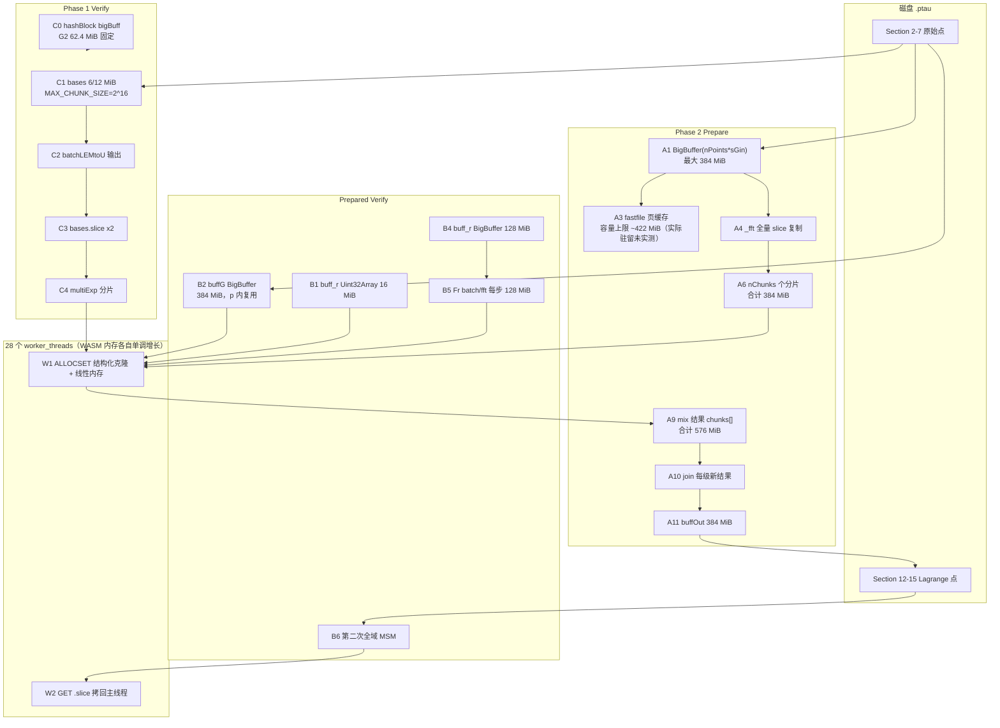

# M3-A｜Powers of Tau 源码级内存分配审计

> 本文件只做**源码审计**，不含任何实测数据。实测值见 `docs/MEMORY_BASELINE.md` 与
> `results/raw/m3_*.json`。本轮不修改 snarkjs / ffjavascript 的任何计算逻辑。

## 0. 审计对象与执行代码一致性

| 组件 | 版本 | 审计的源文件 | 实际被 `node` 执行的文件 |
| --- | --- | --- | --- |
| snarkjs | 0.7.6 | `node_modules/snarkjs/src/powersoftau_{verify,preparephase2}.js` | `node_modules/snarkjs/build/cli.cjs`（rollup CJS bundle） |
| ffjavascript | 0.3.1 | `node_modules/ffjavascript/src/{bigbuffer,engine_fft,engine_multiexp,engine_batchconvert,threadman,threadman_thread,utils,osfile?}.js` | `node_modules/ffjavascript/build/main.cjs` |
| @iden3/binfileutils | 0.0.12 | `node_modules/@iden3/binfileutils/src/binfileutils.js` | bundle |
| fastfile | 0.0.20 | `node_modules/fastfile/src/{fastfile,osfile}.js` | bundle |

`build/cli.cjs` 通过 `require("ffjavascript")` 加载 `build/main.cjs`。已核对两个 bundle 与
ESM 源码的关键语句逐条对应（例如 `main.cjs:5088` 的 `buff = buff.slice(0, buff.byteLength)`，
`main.cjs:4392` 的 `MEM_SIZE = 25`，`cli.cjs:1935` 的 `MAX_CHUNK_SIZE = 1<<16`）。下文同时给出
**src 行号**（便于阅读）与 **bundle 行号**（便于说明实际执行路径）。

## 1. 常量与尺寸口径（BLS12-381）

在本机 `node -e "getCurveFromName('bls12-381')"` 实测：

| 量 | 值 |
| --- | --- |
| `Fr.n8` | 32 B |
| `G1.F.n8` / `G2.F.n8` | 48 B / 96 B |
| affine G1 / G2 点 | 96 B / 192 B |
| jacobian（`sMid`）G1 / G2 点 | 144 B / 288 B |
| `Fr.s`（标量域 2-adicity） | **32** |
| `tm.concurrency`（=`min(os.cpus().length, 64)`） | **28**（本机 28 逻辑核） |
| `BigBuffer.PAGE_SIZE` | 1 GiB（`bigbuffer.js:2`） |
| fastfile 默认 `cacheSize` / `pageSize` | 64 KiB / 8 KiB（`fastfile/src/fastfile.js:7-8`） |

记 `N = 2^power`。最大测试目标 `power=21` 时 `N = 2,097,152`。

**Power 21 的关键缓冲区理论尺寸**（未实测，仅源码推导）：

| 对象 | 点数 | 单点 | 字节 | MiB |
| --- | ---: | ---: | ---: | ---: |
| Prepare：Tau G1 `p=power+1=22` | `2^22` | 96 | 402,653,184 | **384** |
| Prepare：Tau G2 `p=21` | `2^21` | 192 | 402,653,184 | **384** |
| Prepare：Alpha/Beta G1 `p=21` | `2^21` | 96 | 201,326,592 | 192 |
| Verify：Lagrange `buff_r`（`nPoints*n8r`，`p=22`） | `2^22` | 32 | 134,217,728 | 128 |
| Verify：Lagrange `buff_r` 初始 `Uint32Array` | `2^22` | 4 | 16,777,216 | 16 |
| FFT 每 chunk `pointsInChunk=2^14`（G1 affine） | 16,384 | 96 | 1,572,864 | 1.5 |
| FFT 每 chunk 的 WASM `ALLOC`（G1 jacobian） | 16,384 | 144 | 2,359,296 | 2.25 |
| Phase 1 Verify 单块 `MAX_CHUNK_SIZE=2^16`（G1 / G2） | 65,536 | 96 / 192 | 6,291,456 / 12,582,912 | 6 / 12 |

### 一个必须纠正的先验判断

`lagrangeEvaluations`（`engine_fft.js:443-490`）与 `_fft`（`engine_fft.js:83`）中的
`_fftExt` / `_fftExtInv` / `t0,t1` 分支，只在 **`bits == Fr.s+1 = 33`**（即 `2^33` 点）时才进入；
`lagrangeEvaluations` 的 `bits > Fr.s` 分支同样要求 `bits ≥ 33`。BLS12-381 的 `Fr.s = 32`，
而 Power 21 的最高 `bits = power+1 = 22`。因此：

* 本项目的全部规模（`power ≤ 21`）**只走 `_fft` 的常规 IFFT 路径**；
* `preparephase2.js:46-94` 中带 `t0 = new BigBuffer(...)`、`t1 = new BigBuffer(...)` 的整段
  ifft/扩展逻辑**被 `/* ... */` 注释掉**，从不执行；
* 大量复制确实存在，但来源不是扩展 FFT 的 `t0/t1`，而是下面的 A4–A12。

这一区别很重要：它决定 H1（consume-input FFT）应该改的是 `_fft` 常规路径，而不是扩展路径。

## 2. 三个阶段的调用关系

```
[A] Phase 1 Verify（_0001.ptau，Sections 12-15 缺席）
powersoftau_verify.js:128 powersOfTauVerify
 ├─ readPTauHeader / readContributions        小缓冲
 ├─ calculateFirstChallengeHash              hashBlock 的 341000 元素大缓冲 C0（G2 62.4 MiB）
 ├─ verifyContribution x contributions        配对检查（小）
 ├─ processSection(2,3,4,5) x4               <── MAX_CHUNK_SIZE = 1<<16 分块
 │   └─ fd.read(n*sG) → batchLEMtoU → hash → bases.slice x2 → multiExpAffine
 └─ verifyLagrangeEvaluations                **跳过**（无 Sections 12-15）
     └─ logger.warn("this file does not contain phase2 precalculated values")

[B] Phase 2 Prepare
powersoftau_preparephase2.js:24 preparePhase2
 ├─ createBinFile(..., 11 sections) + copySection(2..7)   <── 8 KiB 分页复制
 └─ processSection(2→12, 3→13, 4→14, 5→15)
     └─ for p = 0..power (+power+1 for Section 2):
         processSectionPower(p):
           buff = new BigBuffer(nPoints*sGin)          <── A1
           fdOld.readToBuffer(buff, ...)               <── A2（隐式页缓存 A3）
           buff = G.lagrangeEvaluations(buff, affine, affine)
             └─ G.ifft → _fft                          <── A4..A10
           fdNew.write(buff)                          <── A11

[C] Phase 2 Prepared Verify（_final.ptau，Sections 12-15 存在）
powersoftau_verify.js:128
 ├─ 与 [A] 完全相同的 Phase 1 贡献验证
 └─ verifyLagrangeEvaluations x4（G1 tau / G2 tau / G1 alpha / G1 beta）
     └─ for p = 0..power (+power+1 for tauSection==2):
         verifyPower(p):
           buff_r = new Uint32Array(nPoints)           <── B1
           buffG  = new BigBuffer(nPoints*sG)          <── B2
           G.multiExpAffine(buffG, buff_r)             <── B3
           buff_r = new BigBuffer(nPoints*n8r)         <── B4
           Fr.batchToMontgomery / Fr.fft / batchFromMontgomery  <── B5
           fd.readToBuffer(buffG, ...) 读取 Section 12-15（复用 B2）
           G.multiExpAffine(buffG, buff_r)             <── B6
```

**结论**：`MAX_CHUNK_SIZE = 1<<16` 只约束 [A] 的 `processSection`；[B] 的 FFT 与 [C] 的
`verifyLagrangeEvaluations` 都按 `2^p` 全域分配，不能用「每块最多 6/12 MiB」估计峰值。

### 分配关系图（按对象，不按调用顺序）



图中 `W1/W2` 属于**同一进程**（`worker_threads`），所以其内存计入被测 `node.exe` 的
Peak Working Set；图中没有独立子进程。

## 3. 完整内存分配表

内存类别：
* **JS-EXT** — `Uint8Array` / `BigBuffer` 背后的 ArrayBuffer 外部内存（不在 V8 堆上限内，但计入进程工作集）
* **JS-HEAP** — 普通 JS 对象 / 数组 / Promise 状态
* **WASM** — `WebAssembly.Memory` 线性内存，每个 worker 独立一份
* **PAGE** — fastfile 的 OS 文件页缓存（`new Uint8Array(pageSize)`，也是 JS-EXT，单列便于追踪）

「复制」列：`copy` = 真实字节复制；`view` = 零拷贝视图；`alloc` = 新分配空缓冲。

| ID | 位置（src → bundle） | 表达式 | 类别 | 是否复制 | Power 21 理论量级 | 创建时机 / 生命周期 | 最早可释放点 |
| --- | --- | --- | --- | --- | --- | --- | --- |
| A1 | `preparephase2.js:75` → `cli.cjs:2682` | `buff = new BigBuffer(nPoints*sGin)` | JS-EXT | alloc | 384 MiB（G1 p=22 / G2 p=21） | 每个 `processSectionPower(p)` 开头；变量在 `buff = await ...` 赋值前一直被 caller 持有 | `lagrangeEvaluations` 返回、caller 完成赋值后（`buff` 旧值失去引用，实际回收取决于 GC） |
| A2 | `preparephase2.js:79,82` → `cli.cjs:2686,2689` | `fdOld.readToBuffer(buff, 0, nPoints*sGin)` | PAGE | 读入（每页 `dstView.set(srcView)` 复制） | 目标 384 MiB + 页缓存容量上限约 422 MiB（实际驻留未实测） | 读 Section 期间 | `endReadSection` 后 `fd.pages` 仍持有 `maxPagesLoaded` 个页缓冲，直到 `fdOld.close()` |
| A3 | `fastfile/src/osfile.js:285-288` | `if (len > pageSize*maxPagesLoaded*0.8) maxPagesLoaded = floor(len*1.1/pageSize)+1` | PAGE | alloc（每页 8 KiB） | **`≈422 MiB`（容量上限）**（`floor(402,653,088*1.1/8192)+1 = 54,068` 页 × 8 KiB = 442,925,056 B） | 首次大 `readToBuffer` 时把 `maxPagesLoaded` 从 9 永久放大 | 只靠 `fd.close()`；`_triggerLoad` 把淘汰页放进 `avBuffs` **复用**，不会把内存还给 OS；**实际驻留取决于按需创建与复用，M3 未实测** |
| A4 | `engine_fft.js:73` → `main.cjs:5088` | `buff = buff.slice(0, buff.byteLength)` | JS-EXT | **copy（全量）** | 384 MiB | `_fft` 入口；保护调用方数据不被 `buffReverseBits` 原地打乱 | `_fft` 返回后；但调用方的 A1 直到赋值完成才释放，两者**同时存活** |
| A5 | `utils.js:216-230` → `main.cjs` 同函数 | `buffReverseBits(buff, sIn)` | JS-EXT | 原地交换，每元素两次 96/192 B `slice()` | 峰值增量可忽略（每元素小临时块） | A4 之后立即执行 | 立即 |
| A6 | `engine_fft.js:124` → `main.cjs:5139` | `buffChunk = buff.slice(i*chunk*sIn, ...)` × `nChunks` | JS-EXT | **copy（分片全量）** | G1 p=22：256 × 1.5 MiB = **384 MiB** | `for i in 0..nChunks` 中**全部先创建**并随 task 一起入队 | task 被 worker 消费后（但 `promises[]` / `queueAction` 仍持有引用直到 `Promise.all` 完成） |
| A7 | `engine_fft.js:123,125` → `main.cjs` | `{cmd:"ALLOC", len:sMid*pointsInChunk}` + `{cmd:"SET", buff:buffChunk}` | WASM | **copy（结构化克隆 + `setBuffer`）** | 每个在飞任务 2.25 MiB（G1）／4.5 MiB（G2），28 个 worker 并发 | worker 收到 task 时 | `runTask` 结束把 `u32[0] = oldAlloc` 复位指针；**WASM `memory.grow` 不回缩**，内存仍计入工作集 |
| A8 | `threadman.js:47,68-73` → `main.cjs` | `postMessage(e, transfers)`，`queueAction` 未传 `transfers` | JS-EXT（worker 侧） | **copy（结构化克隆）** | 与 A6 同量级，按在飞任务计 | 任务派发 | worker 消息处理结束 |
| A9 | `engine_fft.js:145,147` + `threadman_thread.js:109` | `{cmd:"GET"}` → `getBuffer(...).slice()` | JS-EXT | **copy（结果出 WASM）** | G1 mix 阶段：256 × 2.25 MiB = **576 MiB** 的 `chunks[]` | `await Promise.all(promises)` 之后 | 每轮 join 用 `chunks[o]=resChunk[0]` 覆盖引用；旧缓冲仅靠 GC |
| A10 | `engine_fft.js:158-223`（join 循环） | 每级 `nChunks` 个 task 各含 2×`ALLOCSET` + 2×`GET` | WASM + JS-EXT | copy | 每级又生成约 576 MiB 新 chunk 结果，共 `bits-l2Chunk = 8` 级 | 串行逐级 `await Promise.all(opPromises)` | 每级结束；但 `res` 数组与 `chunks[]` 同时存在 |
| A11 | `engine_fft.js:226-228` → `main.cjs:5241,5243` | `buffOut = new Uint8Array(nPoints*sOut)`（或 `BigBuffer`） | JS-EXT | alloc | 384 MiB（affine→affine） | 全部 join 完成后 | `fdNew.write(buff)` 结束；`delete chunks[i]`（`:236,239,243`）逐个释放 chunk 引用 |
| A12 | `fastfile/src/osfile.js:229-266` | `fdNew.write(buff)`：`buff.slice(...)` 按 8 KiB 页写入 | PAGE | copy | 单页 8 KiB；写侧 `maxPagesLoaded` 保持初始 9 页 = 72 KiB | 写出 Sections 12-15 | `fdNew.close()` |
| A13 | `binfileutils.js:100-115` | `copySection`：`chunkSize = pageSize`，逐块 `read(l)` + `write(buff)` | JS-EXT + PAGE | copy | 每块 8 KiB | Prepare 开头复制 Sections 2-7 | 每块循环结束 |
| B1 | `verify.js:425` → `cli.cjs:2019` | `buff_r = new Uint32Array(nPoints)` → `new Uint8Array(buff_r.buffer,...)` | JS-EXT | view（零拷贝转型） | 16 MiB（p=22） | 每个 `verifyPower(p)` | `buff_r` 被 B4 覆盖时 |
| B2 | `verify.js:443` → `cli.cjs:2037` | `buffG = new BigBuffer(nPoints*sG)` | JS-EXT | alloc | 384 MiB（G1 p=22）／384 MiB（G2 p=21） | 每个 `verifyPower(p)`；**在同一个 p 内被复用来读 Section 12-15** | `verifyPower` 返回；跨 p 的旧缓冲只靠 GC |
| B3 | `verify.js:452` | `G.multiExpAffine(buffG, buff_r, ...)` | JS-EXT + WASM | copy | 见 A6/A7/A8 同型，另加 `_multiExp` 的 `buffBases.slice` 分片 | p 内第一次 MSM | 函数返回 |
| B4 | `verify.js:454` → `cli.cjs:2049` | `buff_r = new BigBuffer(nPoints*n8r)` | JS-EXT | alloc | 128 MiB | 第一次 MSM 之后 | 被 B5 的结果覆盖时 |
| B5 | `verify.js:470,472,474` | `Fr.batchToMontgomery → Fr.fft → Fr.batchFromMontgomery` | JS-EXT + WASM | 每一步都产生全量新缓冲（A4/A6/A9/A11 同型，Fr 元素 32 B） | 每步 128 MiB；Fr FFT 另有 128 MiB 分片与 128 MiB 输出 | 第一次 MSM 之后 | 每步赋值后，仅靠 GC |
| B6 | `verify.js:477-482` | `fd.readToBuffer(buffG, ...)`（复用 B2）+ 第二次 `multiExpAffine` | PAGE + JS-EXT + WASM | copy | 页缓存再增长（Fr/点读约 128 MiB 级别）+ MSM 分片 | p 内第二次 MSM | `verifyPower` 返回 |
| C0 | `powersoftau_utils.js:340-349` | `calculateFirstChallengeHash` 的 `hashBlock`：`bigBuff = new Uint8Array(blockSize * buff.byteLength)`，`blockSize = 341000` | JS-EXT | alloc + 逐元素 `set` 填充 | **G1 31.2 MiB / G2 62.4 MiB**，与 power 无关；4 次 `hashBlock` 各建一份 | 每次 `powersoftau verify` 开头（三种操作都有） | `hashBlock` 返回后仅靠 GC；源码无显式释放 |
| C1 | `verify.js:340-395` → `cli.cjs:1935` | `bases = fd.read(n*sG)`（`n ≤ 65,536`） | JS-EXT + PAGE | copy | G1 6 MiB / G2 12 MiB；页缓存 `≈1.1×len` | Phase 1 每个分块 | 块循环下一轮覆盖 `bases` |
| C2 | `verify.js:358` | `basesU = await G.batchLEMtoU(bases)` | JS-EXT + WASM | 全量新输出 + 28 个分片（`engine_batchconvert.js:20,42`） | 6 / 12 MiB 输出 + 6 / 12 MiB 分片 | 每块 | 块结束 |
| C3 | `verify.js:361,371-372` | `scalars = getRandomBytes(4*(n-1))`；`bases.slice(0,(n-1)*sG)`；`bases.slice(sG)` | JS-EXT | **copy x2** | 每块 2 × 6 MiB（G1）／2 × 12 MiB（G2） | 每块 | 两次 `multiExpAffine` 返回 |
| C4 | `engine_multiexp.js:131-132` | `buffBasesChunk` / `buffScalarsChunk` × 分片，全部 `Promise.all` | JS-EXT + WASM | copy | 单块内再复制约 6 / 12 MiB | 每块 MSM | `Promise.all` 结束 |
| W0 | `threadman.js:21,61` → `main.cjs:4392,4427` | `tm.memory = new WebAssembly.Memory({initial:25})` | WASM | alloc | 主线程 1.6 MiB | 曲线构建时 | 进程结束 |
| W1 | `threadman.js:104-138` + `threadman_thread.js:33,44-55` | 28 个 worker，各 `new WebAssembly.Memory({initial:25, maximum:32767})` | WASM | alloc + `memory.grow` | 初始 28 × 1.6 MiB ≈ 45 MiB；**随任务单调增长，不回缩** | 曲线构建时 | `tm.terminate()`；snarkjs CLI 在退出前通常不显式调用 |

## 4. `slice()` 到底复不复制

| 调用 | 实现 | 结果 |
| --- | --- | --- |
| `BigBuffer.slice(fr,to)`，长度 < 1 GiB | `bigbuffer.js:24-25`：`return this.buffers[0].slice(fr%PAGE_SIZE, ...)` → `Uint8Array.prototype.slice` | **复制**，返回 `Uint8Array` |
| `BigBuffer.slice`，长度 > 1 GiB | `bigbuffer.js:38-49`：`new BigBuffer(len)` / `new Uint8Array(len)` + `buff.set(srcView,...)` | **复制**，返回 `BigBuffer` |
| `Uint8Array.prototype.slice` | ECMAScript 标准 | **复制** |
| `new Uint8Array(buf.buffer, byteOffset, len)` | 例如 `osfile.js:291`、`bigbuffer.js:36` | **零拷贝视图** |
| `new Uint8Array(buff_r.buffer, ...)`（B1） | 转型 | **零拷贝视图** |
| `threadman_thread.js:66` `getBuffer()` | 视图 | **零拷贝**；紧随其后的 `.slice()`（`GET`）才是复制 |

本项目所有缓冲区都 < 1 GiB（最大 384 MiB），因此 `BigBuffer.slice` 恒走第一条分支。
**A4 的 `buff = buff.slice(0, buff.byteLength)` 确实是一次 384 MiB 的真实全量复制**，
且复制后 `buff` 从 `BigBuffer` 变成 `Uint8Array`，于是 A11 的 `buffOut` 也变成 `Uint8Array`
（`engine_fft.js:225-229` 的 `instanceof BigBuffer` 判断为假）。

## 5. 三类内存为何不能混算

| 类别 | 归属 | 是否被 `--max-old-space-size` 限制 | 计入 Peak Working Set |
| --- | --- | --- | --- |
| JS-HEAP（对象、Promise、`chunks[]`、`promises[]`） | V8 堆 | 是 | 是 |
| JS-EXT（ArrayBuffer / BigBuffer / Uint8Array 数据） | V8 外部内存，由 ArrayBuffer allocator 管理 | 否 | 是 |
| WASM（`WebAssembly.Memory`） | 每个 worker 独立的线性内存 | 否 | 是（同一进程的线程共享工作集） |
| PAGE（fastfile 页缓存） | JS-EXT | 否 | 是 |
| OS 文件页缓存（内核） | 内核，不属于进程 | 否 | 部分计入工作集（共享 / 映射页），**不可与用户态缓冲简单相加** |

因此「384 MiB 输入缓冲区」**不是**峰值内存。仅 Prepare 的第一层就有：
A1(384) + A2/A3 页缓存容量上限(≈422) + A4 全量复制(384) + A6 分片(384) + A9 mix 输出(576)
+ A10 join 输出(576) + A11 输出(384) + W1(≥45) ≈ **3.1 GiB 量级的活跃用户态数据**，
且这些缓冲的存活区间由 GC 决定，可能叠加而非顺序替换。这个数字是**理论推导，不是实测**，
M3-D 的任务就是用 Peak Working Set 给出真实答案。

## 6. 可释放点与现实约束

源码里只有三处显式释放：

1. `engine_fft.js:236,239`：组装 `buffOut` 时 `delete chunks[i]`；
2. `preparephase2.js:86-88`（**注释掉的代码块内**）：`t0 = null`，本轮不会执行；
3. `threadman_thread.js:116`：`u32b[0] = oldAlloc` 复位 WASM 分配指针 —— **只复位指针，
   不 `memory.grow(-n)`**，线性内存不会缩小。

其余全靠变量出作用域 + V8 GC。JS 的 GC 不保证及时回收 384 MiB 级的外部 ArrayBuffer；
「理论生命周期结束」≠「工作集下降」。另外：

* `Promise.all(promises)`（A6/A9）与 `Promise.all(opPromises)`（A10）让**同一批全部分片同时存活**，
  这是比单次全量复制更值得注意的峰值来源；
* `fastfile` 的 `avBuffs` 复用机制让 A3 的页缓冲在 `fd` 生命周期内持续持有（容量上限约 422 MiB，实际驻留随按需创建与复用而定，M3 未实测）；
* `tm.singleThread` 为 false，28 个 worker 的 WASM 内存各自增长且互不共享。

## 7. H1（consume-input FFT）的源码级前置判断

用户的假设是：在 `preparePhase2.processSectionPower()` 中，输入缓冲区转换后不再需要原始内容，
可以让 FFT 消耗输入、复用内存，减少全量复制与新输出。逐条核对源码：

| 待确认事项 | 源码结论 |
| --- | --- |
| `buffReverseBits` 是否修改输入 | **是**，`utils.js:216-230` 原地交换。A4 的复制正是为了隔离这个副作用。BigBuffer 自身实现了 `slice`/`set`，原地打乱 BigBuffer 在接口上可行。 |
| 后续 FFT 是否还需要原始输入 | 常规路径中不需要：`buffReverseBits` 之后 `buff` 只用于生成 A6 分片，所有后续计算都基于 `chunks[]`。但 `lagrangeEvaluations` 的 `bits > Fr.s` 扩展分支（`engine_fft.js:483-490`）会 `buff.slice` 出 t0/t1，同样只读一次——对 `power ≤ 21` 不触发。 |
| 分块计算是否保留全部中间结果 | **是**，A6 的 256 个分片全部先构造完再 `Promise.all`；A9 的 256 个 mix 结果全量保留；A10 每级 join 再全量生成新结果。 |
| 输出能否安全复用输入内存 | affine→affine 时 `sIn = sOut`（96/192 B），`byteLength` 相同，**理论上可别名**；但 jacobian→affine 时 `sMid(144/288) ≠ sOut(96/192)`，不能别名。此外 A6 的分片是副本，所以覆盖 `buff` 不会破坏 chunk 数据。 |
| 并行线程是否存在数据竞争 | **无共享输入竞争**：`queueAction` 用 `postMessage` 结构化克隆把每个 task 的数据复制进 worker，WASM 内存按 worker 私有；`GET` 用 `.slice()` 拷出。但如果改为共享内存/转移所有权（`transfers`），必须重新验证。 |

**源码层面的初步判断（尚待 M3-D 实测确认）**：
去掉 A4 那一次 384 MiB 全量复制是安全的，但按第 5 节的量级，A6/A9/A10/A11 才是更大的项。
「只消除一次输入复制」很可能只降低峰值的很小一部分；真正的热点取决于
`Promise.all` 同时持有多少分片，以及 GC 是否及时回收上一轮 join 的 576 MiB。
另外 A3 的 fastfile 页缓存容量上限（≈422 MiB）完全独立于 FFT，但实际驻留未实测、改 FFT 也不会动它。

因此 H1 若要成立，至少需要同时处理：**分片生命周期**（流式派发而不是一次性
`Promise.all`）、**join 级结果复用**、**输出别名**，并给出
`Optimized Output = Original Output` 的 Sections 12–15 逐字节核对 + snarkjs 完整验证。
本轮按用户要求**不实现**任何优化，只把这条判断留作 M3 之后的可检验假设。

## 8. 本审计的可复现方式

```bash
# 版本与常量
node -e 'const p=require("./node_modules/snarkjs/package.json");console.log(p.version)'
node -e 'const {getCurveFromName}=require("ffjavascript");getCurveFromName("bls12-381").then(c=>{console.log(c.Fr.s,c.Fr.n8,c.G1.F.n8,c.G2.F.n8,c.G1.tm.concurrency)})'
# 关键分配点
grep -n "new BigBuffer\|MAX_CHUNK_SIZE\|lagrangeEvaluations" node_modules/snarkjs/src/powersoftau_verify.js
grep -n "buff.slice(0, buff.byteLength)\|buffOut = new\|const buffChunk" node_modules/ffjavascript/src/engine_fft.js
grep -n "maxPagesLoaded" node_modules/fastfile/src/osfile.js
```

所有行号基于本机 `package-lock.json` 锁定的 snarkjs 0.7.6 / ffjavascript 0.3.1 /
@iden3/binfileutils 0.0.12 / fastfile 0.0.20。
